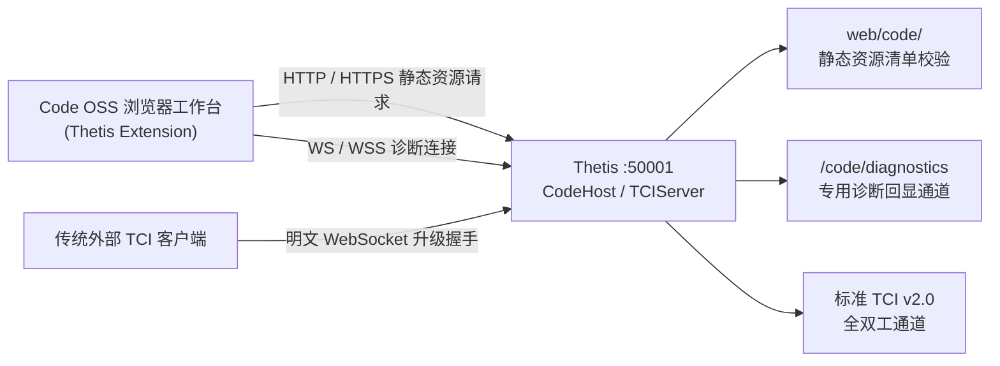

# Thetis-Web

[](https://microsoft.com/windows)
[](file:///d:/workspace/Thetis/CMakeLists.txt)
[](file:///d:/workspace/Thetis/Project%20Files/Source/Console/Thetis.csproj)
[](file:///d:/workspace/Thetis/ui/README.md)
[-lightgrey.svg)](file:///d:/workspace/Thetis/submodules/thetis-on-the-web)
[-green.svg)](file:///d:/workspace/Thetis/Project%20Files/Source/Console/TCIServer.cs)
[](file:///d:/workspace/Thetis/.github/workflows/windows-build.yml)

**Thetis-Web** 是专为 OpenHPSDR / ANAN 系列软件无线电 (SDR) 打造的现代化、高集成度版本。本项目**完全脱离了 Visual Studio IDE 方案文件** 依赖，全面重构为纯 **CMake + MSVC + .NET CLI** 现代构建流水线，并在 VS Code 中提供开箱即用的一流开发、构建、调试与测试体验。

> [!IMPORTANT]
> **重要架构声明：旧版 WebUI 已正式进入 Legacy 历史归档状态**
>
> 早期子模块 [thetis-on-the-web](file:///d:/workspace/Thetis/submodules/thetis-on-the-web)（TOTW / `totw.html`）现已**正式进入 Legacy 历史归档状态，仅作为算法与架构设计参考保留于源码树，不再参与任何编译、构建、测试与运行时部署**。
>
> 当前项目**唯一活跃且正式维护**的浏览器端工作台为 **Thetis Code OSS Foundation**（基于 Code OSS 1.146.0 深度定制，前端代码位于 [ui/](file:///d:/workspace/Thetis/ui/)，运行时部署于 [Project Files/bin/x64/Release/web/code/](file:///d:/workspace/Thetis/Project%20Files/bin/x64/Release/web/code/)，由 [CodeHost.cs](file:///d:/workspace/Thetis/Project%20Files/Source/Console/Hosting/CodeHost.cs) 在单端口 50001 提供 HTTP/WebSocket 多路复用服务）。

---

## 目录 (Table of Contents)

- [核心特色](#核心特色)
- [项目架构与模块说明 (STRUCTURE.md)](#项目架构与模块说明-structuremd)
- [环境与依赖要求](#环境与依赖要求)
- [编译与构建指南](#编译与构建指南)
  - [1. 一键脚本构建 (推荐)](#1-一键脚本构建-推荐)
  - [2. VS Code 原生集成构建](#2-vs-code-原生集成构建)
  - [3. CLI 分步手动构建](#3-cli-分步手动构建)
  - [4. Code OSS Web 前端独立构建](#4-code-oss-web-前端独立构建)
  - [构建产物目录结构](#构建产物目录结构)
- [GitHub Actions 云端 CI 构建流水线](#github-actions-云端-ci-构建流水线)
  - [流水线设计特色](#流水线设计特色)
  - [触发方式](#触发方式)
  - [多层缓存与常驻编译服务优化](#多层缓存与常驻编译服务优化)
- [程序启动指南](#程序启动指南)
  - [方式一：启动 Code OSS Foundation 演示诊断模式 (推荐免硬件)](#方式一启动-code-oss-foundation-演示诊断模式-推荐免硬件)
  - [方式二：启动 WinForms 并启用内嵌 Web 服务](#方式二启动-winforms-并启用内嵌-web-服务)
  - [方式三：启动标准桌面版 (Desktop Mode)](#方式三启动标准桌面版-desktop-mode)
- [WebUI 单端口多路复用机制详解](#webui-单端口多路复用机制详解)
- [WebUI 常用操作与快捷键](#webui-常用操作与快捷键)
- [Git Submodule 子模块管理](#git-submodule-子模块管理)
- [常见问题排查 (FAQ)](#常见问题排查-faq)
- [许可证与鸣谢](#许可证与鸣谢)

---

## 核心特色

1. **彻底解耦 Visual Studio IDE**：
   - 清除所有旧版 `.sln`、`.vcxproj`、`.vcxproj.filters` 及 `.vs/` 冗余配置文件；
   - 原生 C/C++ 算法与硬件核心（[`PA19.dll`](file:///d:/workspace/Thetis/cmake/PA19.cmake)、[`wdsp.dll`](file:///d:/workspace/Thetis/Project%20Files/Source/wdsp/)、[`cmASIO.dll`](file:///d:/workspace/Thetis/Project%20Files/Source/cmASIO/)、[`ChannelMaster.dll`](file:///d:/workspace/Thetis/Project%20Files/Source/ChannelMaster/)）统一通过现代 [CMakeLists.txt](file:///d:/workspace/Thetis/CMakeLists.txt) 管理，支持 Ninja 并行加速；
   - 托管层 C# 程序通过现代 .NET CLI (`dotnet build`) 直接编译。
2. **VS Code 优先的一流开发体验**：
   - 预置 [.vscode/tasks.json](file:///d:/workspace/Thetis/.vscode/tasks.json)：<kbd>Ctrl</kbd> + <kbd>Shift</kbd> + <kbd>B</kbd> 一键多任务编译；
   - 预置 [.vscode/launch.json](file:///d:/workspace/Thetis/.vscode/launch.json)：一键启动、混合代码断点调试；
   - 预置完整路径检索与源码符号关联。
3. **Thetis Code OSS 现代浏览器工作台 (Stage 1 Foundation)**：
   - 固定版本的上游 Code OSS 1.146.0 提供原生工作台能力，Thetis 专用扩展与嵌入宿主源码由父仓库独立维护；
   - 深度支持视图拖拽移动、合成 Console 编辑器标签页、Classic / Midnight 双无线电外观皮肤、多档显示密度与布局持久化存储；
   - 嵌入式 C# 单端口（50001）多路复用服务直接提供资源与诊断连接，无需启动外部 Node.js 或 Python Web 服务；
   - 提供免硬件运行的演示诊断模式 (`Thetis.exe -code-demo`)，便于快速调试与界面演化。
4. **工业级 GitHub Actions 云端 CI 构建流水线**：
   - 采用单 Job 三阶段流水线 ([.github/workflows/windows-build.yml](file:///d:/workspace/Thetis/.github/workflows/windows-build.yml))：Phase 1 还原与多层原生缓存恢复、Phase 2 编译与双重自动化测试、Phase 3 过期缓存清理与新缓存写入；
   - 原生分层缓存（NuGet、构建工具、UI 依赖、pnpm store、Code OSS 预编译包），将云端构建耗时压缩至 3 分钟级；
   - 全面启用 Roslyn 编译器常驻服务 (`Directory.Build.props` 设置 `UseSharedCompilation=true` 与 `MSBUILDUSESERVER=1`)，大幅加速 C# 编译；
   - 采用主动手动触发 (`workflow_dispatch`) 与 PR 审查双重触发机制，防止无意义的高频触发消耗 CI 额度，且内置自动化过期缓存清理。
5. **历史 WebUI 正式归档 (Legacy Reference Only)**：
   - 旧版 [thetis-on-the-web](file:///d:/workspace/Thetis/submodules/thetis-on-the-web) 完整归档，保留 Vanilla JS、Web Audio 及 Canvas 2D 实现仅供技术演进与算法对比参考；
   - 构建系统不再将旧版 WebUI 复制或部署到发行目录中。

---

## 项目架构与模块说明 (STRUCTURE.md)

本项目拥有详细的原生 C/C++ 算法、通道路由网络、音频驱动、托管 C# 应用程序及单端口 WebUI 的架构与接口技术剖析。

详细内容请参阅：[STRUCTURE.md](file:///d:/workspace/Thetis/STRUCTURE.md)
- **底层原生 DSP 核心**：[wdsp](file:///d:/workspace/Thetis/Project%20Files/Source/wdsp/) (FFTW3, RNNoise, SpecBleach, MMCSS)
- **原生通道路由与网络引擎**：[ChannelMaster](file:///d:/workspace/Thetis/Project%20Files/Source/ChannelMaster/) (Protocol 1 & 2, WinSock2, 无锁环形缓冲区)
- **底层音频驱动**：[cmASIO](file:///d:/workspace/Thetis/Project%20Files/Source/cmASIO/) (Steinberg ASIO SDK) 与 [PA19](file:///d:/workspace/Thetis/cmake/PA19.cmake) (PortAudio 19.7, WASAPI, WDM-KS, MME)
- **托管 C# 应用程序**：[Thetis Console](file:///d:/workspace/Thetis/Project%20Files/Source/Console/) (SharpDX DirectX 11/2D, SkiaSharp, NAudio, WinForms)
- **单端口 50001 服务与宿主**：[TCIServer.cs](file:///d:/workspace/Thetis/Project%20Files/Source/Console/TCIServer.cs)、[CodeHost.cs](file:///d:/workspace/Thetis/Project%20Files/Source/Console/Hosting/CodeHost.cs)
- **现代浏览器工作台**：[Thetis Extension & Host](file:///d:/workspace/Thetis/ui/) (Code OSS 1.146.0, TypeScript)
- **历史归档 WebUI (Legacy)**：[thetis-on-the-web](file:///d:/workspace/Thetis/submodules/thetis-on-the-web/) (仅保留源码作参考)

---

## 环境与依赖要求

在开始本地构建前，请确保系统已安装以下工具：

| 工具 / 依赖 | 最低要求版本 | 说明 |
| :--- | :--- | :--- |
| **操作系统** | Windows 10 / 11 64-bit | 纯 64 位 (x64) 运行环境 |
| **MSVC 编译器** | Visual Studio 2022 或 Build Tools | 仅需安装 "使用 C++ 的桌面开发" 工作负载中的 MSVC v143 编译器与 Windows 10/11 SDK |
| **CMake** | >= 3.20 | 跨平台原生构建定义工具 |
| **Ninja** | >= 1.10 (推荐) | 高速并行构建执行器 |
| **.NET SDK** | .NET 8.0 / 9.0 / 10.0 | 提供 `dotnet build` 命令（需包含 .NET Framework 4.8 目标包支持） |
| **Git** | 最新版本 | 包含 submodule 支持与 GitHub CLI (`gh`) |
| **Node.js & pnpm** | Node 24.22.1 / pnpm 12.16.0 | 用于构建 Code OSS 浏览器工作台（构建脚本会自动下载并管理固定版本） |

---

## 编译与构建指南

### 1. 一键脚本构建 (推荐)

仓库根目录提供了全自动环境探测与编译脚本，能自动检测 MSVC 路径、同步 Submodule、还原 NuGet 并完整编译原生动态库、C# 程序及部署 WebUI 资源：

#### 使用 PowerShell (推荐)：
```powershell
# 完整编译 Release 版本 (推荐)
.\build.ps1 -All -Config Release

# 仅编译原生 C/C++ 核心 DLL (快速迭代底层算法)
.\build.ps1 -Config Release

# 编译 Debug 调试版本
.\build.ps1 -All -Config Debug

# 清理构建缓存
.\build.ps1 -Clean
```

#### 使用 CMD 命令行：
```cmd
:: 完整编译 Release 版本
build.bat Release all

:: 仅编译原生核心 DLL
build.bat Release

:: 完整编译 Debug 版本
build.bat Debug all

:: 清理构建目录
build.bat clean
```

> [!TIP]
> 运行构建脚本时，如果发现后台有未关闭的 `Thetis.exe`，脚本会自动尝试停止该进程，以防 Windows 文件锁导致 `Permission denied` 报错。

---

### 2. VS Code 原生集成构建

在 VS Code 中打开本仓库：
- **默认构建**：直接按下快捷键 <kbd>Ctrl</kbd> + <kbd>Shift</kbd> + <kbd>B</kbd>，触发 `Build All (Release)` 任务。
- **选择性任务**：按下 <kbd>Ctrl</kbd> + <kbd>Shift</kbd> + <kbd>P</kbd>，输入 `Tasks: Run Task` 并回车：
  - `Build All (Release)`：完整构建所有模块 (Release)
  - `Build All (Debug)`：完整构建所有模块 (Debug)
  - `Build Native Core Only (CMake)`：仅增量编译原生 C/C++ DLL
  - `Build C# Thetis Only (dotnet)`：仅增量编译 C# 应用程序
  - `Build Code OSS Browser Bundles`：准备固定版本的上游浏览器包
  - `Build Thetis Foundation UI`：编译父仓库宿主与扩展并复用上游缓存
  - `Clean Build Directory`：清理 CMake build 缓存
  - `Update Git Submodules`：同步固定版本的子模块代码

---

### 3. CLI 分步手动构建

如果你需要在 CI/CD 环境或自定义流水线中分步构建：

```powershell
# 1. 确保子模块就绪
git submodule update --init --recursive

# 2. 还原 C# NuGet 依赖
nuget restore "Project Files/Source/Console/Thetis.csproj" -PackagesDirectory "Project Files/Source/packages"

# 3. 使用 CMake 编译原生 C/C++ 动态库 (Ninja + MSVC)
cmake -B build -G Ninja -DCMAKE_BUILD_TYPE=Release -DCMAKE_C_COMPILER=cl -DCMAKE_CXX_COMPILER=cl
cmake --build build --target native_core

# 4. 使用 dotnet 编译 C# 应用程序 (开启 Roslyn 常驻编译加速)
dotnet build "Project Files/Source/Console/Thetis.csproj" -c Release -p:Platform=x64

# 5. 执行部署目标 (将 DLL 与静态 Web 资源同步至 bin 输出目录)
cmake --build build --target stage_to_project_bin
```

---

### 4. Code OSS Web 前端独立构建

若需单独对浏览器端工作台扩展或嵌入宿主进行开发调试：

```powershell
# 构建上游 Code OSS 浏览器依赖包 (构建结果将被自动缓存)
powershell -NoProfile -ExecutionPolicy Bypass -File ./ui/build-code-web.ps1

# 构建 Thetis 前端扩展、主题变量与嵌入宿主
powershell -NoProfile -ExecutionPolicy Bypass -File ./ui/build-ui.ps1

# 同步静态资源到 Thetis 发行目录
powershell -NoProfile -ExecutionPolicy Bypass -File ./ui/stage-code-web.ps1 -Destination "Project Files/bin/x64/Release/web"
```

---

### 构建产物目录结构

构建完成后，所有最终可执行程序与依赖均位于 [Project Files/bin/x64/Release/](file:///d:/workspace/Thetis/Project%20Files/bin/x64/Release/)：

```text
Project Files/bin/x64/Release/
├── Thetis.exe                     # C# 主程序
├── ChannelMaster.dll              # 多通道信号路由核心 (Native)
├── wdsp.dll                       # 数字信号处理算法核心 (Native)
├── cmASIO.dll                     # 低延迟 ASIO 音频驱动层 (Native)
├── PA19.dll                       # PortAudio 跨平台音频接口 (Native)
├── web/                           # 嵌入式 WebUI 静态资源目录
│   └── code/                      # Code OSS 运行时、Thetis 宿主与扩展资产清单
├── Skins/                         # 界面皮肤资源
└── *.dll                          # C# 依赖托管库 (NAudio, SharpDX 等)
```

---

## GitHub Actions 云端 CI 构建流水线

本项目在 [.github/workflows/windows-build.yml](file:///d:/workspace/Thetis/.github/workflows/windows-build.yml) 中配置了企业级自动化持续集成构建流水线。

### 流水线设计特色

1. **单 Job 三阶段严密架构**：
   - **Phase 1: Environment Preparation & Cache Restoration**：初始化环境，使用 `actions/cache/restore@v4` 恢复 NuGet 包、Node/pnpm 工具链、UI 模块及 Code OSS 预编译工作台产物。
   - **Phase 2: Compilation, Staging & Multi-Level Verification**：依次执行原生 C/C++ 编译、C# 应用程序编译、资源部署、Thetis.Hosting C# 集成测试套件与 UI 前端自动化测试。
   - **Phase 3: Stale Cache Pruning & Cache Preservation**：测试全部通过后，自动化调用 GitHub CLI 清理过期缓存键，并通过 `actions/cache/save@v4` 保存最新缓存版本。
2. **Roslyn 编译器常驻优化**：
   - 在 [Directory.Build.props](file:///d:/workspace/Thetis/Directory.Build.props) 中显式声明 `<UseSharedCompilation>true</UseSharedCompilation>`，并在 CI 环境注入 `MSBUILDUSESERVER=1`，复用 Roslyn 编译进程，避免重复启动带来的 JIT 冷启动损耗。
3. **分层原生缓存机制**：
   - 依赖项与上游 Code OSS 预编译产物完全利用云端 GitHub Actions Cache 隔离存储，本地仓库保持纯净无冗余二进制提交。

### 触发方式

为了杜绝普通文档微调或日常小提交无谓消耗云端运行配额，构建流水线设定为**主动受控触发**：
- **手动触发 (`workflow_dispatch`)**：在 GitHub 仓库页面进入 **Actions** -> 选择 **Windows Build (Consolidated Single-Job with Stale Cache Pruning)** -> 点击 **Run workflow** 执行云端全量构建。
- **拉取请求 (`pull_request`)**：向主分支发起 PR 时自动执行全量质量与测试门禁。

---

## 程序启动指南

### 方式一：启动 Code OSS Foundation 演示诊断模式 (推荐免硬件)

Stage 1 提供免连接物理无线电设备的独立诊断演示启动模式：

```powershell
& '.\Project Files\bin\x64\Release\Thetis.exe' -code-demo
```

启动后在浏览器打开：[http://localhost:50001/code/](http://localhost:50001/code/)（根路径 `/` 亦会自动重定向到 `/code/`）。
- **可交互功能**：合成双 VFO、接收机选择 (RX1/RX2)、模式切换、滤波带宽、射频增益、Classic / Midnight 皮肤切换与自定义布局拖拽；
- **当前状态**：Power、MOX、Tune、PTT 保持安全禁用（属于后续 Stage 2 真实控制接入阶段）；
- **诊断端点**：健康监测接口 [http://localhost:50001/code/health](http://localhost:50001/code/health)。

### 方式二：启动 WinForms 并启用内嵌 Web 服务

启动标准 WinForms 电台主程序，同时在端口 50001 启用内嵌 Code OSS 服务：

```powershell
& '.\Project Files\bin\x64\Release\Thetis.exe' -web
```

### 方式三：启动标准桌面版 (Desktop Mode)

直接运行原生桌面 WinForms 模式：
1. **直接运行可执行文件**：双击运行 `Project Files\bin\x64\Release\Thetis.exe`。
2. **在 VS Code 中启动**：在运行与调试面板选择 **"Launch Thetis (Release)"**，按 <kbd>F5</kbd>。

> [!NOTE]
> **首次启动特别说明**：
> 首次运行 Thetis 时，底层的 WDSP 核心会自动调用 FFTW 算法库为本机 CPU 指令集规划最佳 FFT 执行计划（Wisdom Plan，文件位于 `Project Files/bin/x64/Release/Wisdom/wdspWisdom00`）。
> **初次生成需耗时 1~2 分钟**，期间界面可能短暂等待，这是正常现象。一旦 Wisdom 文件生成完毕，后续启动均为秒级启动。

---

## WebUI 单端口多路复用机制详解

Thetis 嵌入式服务在端口 50001 实现 HTTP/HTTPS 静态资源与 WebSocket 协议的智能分流：



- **静态资源安全分发**：[CodeHost.cs](file:///d:/workspace/Thetis/Project%20Files/Source/Console/Hosting/CodeHost.cs) 通过严格的资源清单校验、防路径穿越检查与流式传输提供资源，请求不会创建电台 TCI 客户端；
- **独立诊断通道**：前端持有 `/code/diagnostics` 专用通道，用于心跳探测与文本指令回显；
- **传统 TCI 兼容**：保留对标准外部 TCI 客户端（如 Log4OM、SDR-Control）的透明接入支持。

---

## WebUI 常用操作与快捷键

| 快捷键 / 操作 | 功能描述 |
| :--- | :--- |
| <kbd>F1</kbd> | 打开 Code OSS 命令面板 |
| <kbd>Tab</kbd> / <kbd>Shift</kbd> + <kbd>Tab</kbd> | 在可用界面控件间切换键盘焦点 |
| <kbd>Enter</kbd> / <kbd>Space</kbd> | 激活当前聚焦的控件按钮 |
| 命令面板：`Thetis: Open Console` | 重新打开或聚焦 Console 核心电台面板 |
| 命令面板：`Thetis: Restore Default Layout` | 恢复 Code OSS 默认电台布局 |
| 视图右键菜单 | 隐藏、停靠或分屏显示各个独立电台仪表板块 |

---

## Git Submodule 子模块管理

本项目涉及以下两个子模块，其职责与状态划分如下：

1. **`submodules/vscode` (核心活跃子模块)**：
   - **远程源**：镜像 Fork 至 [https://github.com/baiyunquan/vscode.git](https://github.com/baiyunquan/vscode.git)；
   - **固定分支**：`thetis-pinned`（固定提交 `fdefc478b9148c1a47f913b3ec618a1226d9f600`，对应 Code OSS 1.146.0）；
   - **功用**：提供纯净的 Web 工作台基础底座，父仓库通过独立前端代码对其进行扩展与宿主定制。
2. **`submodules/thetis-on-the-web` (Legacy 归档子模块)**：
   - **状态**：**Legacy / 历史参考**；
   - **功用**：保留早期 TOTW 单文件 Vanilla JS、Canvas 2D 瀑布流与 Web Audio 实现作为技术对比参考，不再参与任何部署。

更新或初始化子模块：
```powershell
# 同步初始化 Code OSS 活跃子模块
git submodule update --init --recursive submodules/vscode
```

---

## 常见问题排查 (FAQ)

### Q1: 编译时出现 `Permission denied` 或无法写入 `PA19.dll` / `Thetis.exe`
- **原因**：之前启动的 `Thetis.exe` 仍在后台运行，Windows 系统锁定了正在运行的动态库与可执行文件。
- **解决**：在终端执行 `Stop-Process -Name Thetis -Force`，或直接再次运行 `.\build.ps1 -All -Config Release`（脚本内部会自动清理残留进程）。

### Q2: 浏览器打开 `http://localhost:50001/` 提示无法连接
- **解决**：确认使用 `-code-demo` 或 `-web` 参数启动了 Thetis，并确认 50001 端口未被其他程序占用；可访问 [http://localhost:50001/code/health](http://localhost:50001/code/health) 查看健康检查状态。

### Q3: 为什么 Stage 1 中 Power、MOX、Tune、PTT 等发射按键处于不可用状态？
- **原因**：当前处于 Code OSS UI 重构路线图的 **Stage 1 (Foundation)** 阶段，重点保证工作台架构、宿主通信、多引擎兼容与布局持久化；电台真实收发、音频流转与发射控制接入规划在 Stage 2 及后续阶段中逐步实现。

---

## 许可证与鸣谢

- 本项目基于 OpenHPSDR / [ramdor/Thetis](https://github.com/ramdor/Thetis) 与历史 [thetis-on-the-web](https://github.com/baiyunquan/thetis-on-the-web) 演化重构。
- 原生核心遵循开源许可证（详见 [LICENSE](file:///d:/workspace/Thetis/LICENSE) 与 [LICENSE-DUAL-LICENSING](file:///d:/workspace/Thetis/LICENSE-DUAL-LICENSING)）。
- 衷心感谢 OpenHPSDR 社区、Richie (MW0LGE)、OE3IDE、n9bc 及所有无线电爱好者的杰出贡献！
