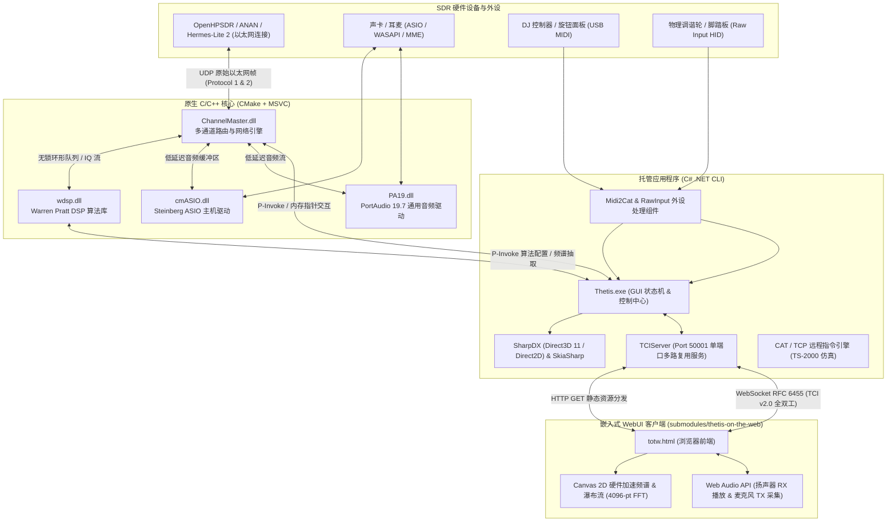

# Thetis-Web 架构与模块体系说明文档 (STRUCTURE.md)

本文档对 Thetis-Web 项目的代码组织结构、核心大模块划分、各模块所依赖的系统 API 与底层库接口，以及端到端数据流与控制流进行深度技术剖析。

---

## 1. 总体架构拓扑 (System Topology)

Thetis-Web 采用分层解耦的混合架构设计：
- **底层原生层 (Native Core, C99 / C++17)**：负责纳秒级时间敏感的数字信号处理 (DSP)、无锁环形缓冲队列、超低延迟音频硬件驱动 (ASIO / PortAudio / WDM-KS / WASAPI) 以及高吞吐 UDP 网络通信 (OpenHPSDR 硬件交互)。
- **托管控制层 (Managed Core, C# / .NET Framework 4.8 on Roslyn)**：负责 Windows Forms 桌面交互、DirectX 11 / Direct2D 硬件加速频谱瀑布流渲染、电台状态机维护、CAT 指令解析、MIDI 映射及单一端口网络多路复用。
- **远程 Web 客户端层 (Embedded WebUI, Vanilla ES6 / HTML5 / Web Audio)**：作为 Git Submodule 嵌入项目，直接由托管层服务于单端口 (Port 50001)，在浏览器内实现零安装的高分辨率频谱显示与双向双工音频/麦克风串流。



---

## 2. 核心大模块详细剖析

### 2.1 原生 DSP 核心模块 (`wdsp.dll`)

- **源码路径**：[Project Files/Source/wdsp/](file:///d:/workspace/Thetis/Project%20Files/Source/wdsp/)
- **开发语言**：C99
- **模块职责**：
  Warren Pratt (NR0V) 编写的高性能数字信号处理库。负责电台全通带及各接收机/发射机通道的基础算法运算。
- **内部核心组件**：
  - `RXA.c` / `TXA.c`：接收 (RX) 与发射 (TX) 算法流水线编排；
  - `bandpass.c` / `cfir.c` / `icfir.c` / `fir.c` / `iir.c`：重叠保留法 (Overlap-Save) 快速卷积滤波器、多抽样率抽取与插值 FIR/IIR 滤波；
  - `wcpAGC.c`：Warren Pratt 自动增益控制，支持针对脉冲噪声优化的可变时间常数衰减；
  - `anr.c` / `anf.c`：自适应谱线增强 (LMS) 与自适应陷波算法；
  - `nob.c` / `nobII.c` / `snb.c` / `nbp.c`：时域多阶段脉冲噪声消除器 (Noise Blanker)；
  - `rnnr.c` / `sbnr.c`：现代深度学习与频谱减算法，集成 RNNoise 循环神经网络降噪与 SpecBleach 谱白化降噪；
  - `ammod.c` / `amd.c` / `fmmod.c` / `fmd.c` / `gen.c`：AM、SAM（同步检波）、FM、SSB、CW 调制解调器；
  - `iqc.c` / `calcc.c`：硬件正交平衡校准 (IQ Imbalance Correction) 与相位/幅度校准；
  - `analyzer.c` / `wisdom.c`：高动态范围频谱分析仪与 FFTW 执行计划缓存管理。
- **调用的系统与第三方库接口**：
  - **`libfftw3-3.dll` / `fftw3.h`**：调用 64 位 FFTW3 库执行 1D 快速傅里叶变换、频域卷积以及 Wisdom 计算计划的本地持久化；
  - **`rnnoise.dll`**：调用递归神经网络降噪动态库，载入预训练权重 (`rnnoise_weights_large.bin`, `rnnoise_weights_small.bin`)；
  - **`specbleach.dll`**：频谱漂白/自适应谱减运算；
  - **`avrt.lib` (Windows MMCSS)**：调用 Windows Multimedia Class Scheduler Service (`AvSetMmThreadCharacteristics`) 将 DSP 线程提升至 Pro Audio 实时优先级别；
  - **C 标准数学库 (`math.h`)**：利用硬件 AVX/FMA 指令集进行浮点运算。

---

### 2.2 原生通道路由与网络引擎 (`ChannelMaster.dll`)

- **源码路径**：[Project Files/Source/ChannelMaster/](file:///d:/workspace/Thetis/Project%20Files/Source/ChannelMaster/)
- **开发语言**：C99
- **模块职责**：
  全系统的通道总调度枢纽。负责在多物理接收通道 (DDC)、发射通道 (DUC)、外部音频设备与托管层之间执行零拷贝/极低延迟的数据分发，并直接驱动 OpenHPSDR 硬件的以太网网络通信。
- **内部核心组件**：
  - `cmaster.c`：通道管理主入口，维护无线电拓扑结构、抽样率转换状态；
  - `network.c` / `netInterface.c` / `networkproto1.c`：OpenHPSDR Protocol 1 与 Protocol 2 网络堆栈，处理原始 UDP 套接字收发、高速 IQ 分包组装、序列号纠错与丢包统计；
  - `ring.c` / `pipe.c` / `cmbuffs.c` / `obbuffs.c`：针对多核并发设计的原子级无锁环形队列 (Lockless Ring Buffer) 与弹性管道，解耦网络收发线程、DSP 计算线程与音频输出线程；
  - `cmasio.c`：与 ASIO 主机驱动层的原生数据缓冲交互；
  - `ivac.c`：虚拟音频电缆 (VAC) 接口支持；
  - `sidetone.c`：纳秒级低抖动 CW 侧音合成器；
  - `vox.c`：高速语音控制发射 (VOX) 与 LookAhead 前瞻延迟队列；
  - `tci.c`：底层原生 TCI 音频与 IQ 数据分发挂钩。
- **调用的系统与第三方库接口**：
  - **`ws2_32.lib` (Windows Sockets 2)**：高性能非阻塞 UDP 套接字通信，支持 48kHz 到 1.536MHz 宽带 IQ 原始射频流的吞吐；
  - **`avrt.lib`**：网络 I/O 线程 MMCSS 实时调度优先级绑定；
  - **`PA19.dll`**：调用 PortAudio 原生流接口；
  - **`cmASIO.dll`**：调用自定义 ASIO 主机驱动接口；
  - **`wdsp.dll`**：向 WDSP 压入各通道 IQ 样本并取出解调后音频。

---

### 2.3 原生音频驱动层 (`cmASIO.dll` 与 `PA19.dll`)

#### `cmASIO.dll` (ASIO 主机驱动)
- **源码路径**：[Project Files/Source/cmASIO/](file:///d:/workspace/Thetis/Project%20Files/Source/cmASIO/)
- **开发语言**：C++17
- **模块职责**：
  封装专业专业声卡厂商提供的 Steinberg ASIO 驱动接口，消除 Windows 系统音频混音器的重采样与缓冲区引入的延迟。
- **调用的系统与第三方库接口**：
  - **Steinberg ASIO SDK 2.3.3**：实现 `asio.cpp`、`asiodrivers.cpp`、`asiolist.cpp`；
  - **`ole32.lib` (Windows COM)**：调用 `CoInitialize`、`CoCreateInstance` 根据 CLSID 创建第三方声卡 ASIO COM 组件；
  - **`advapi32.lib`**：查询注册表项 `HKEY_LOCAL_MACHINE\SOFTWARE\ASIO` 动态发现系统中已安装的 ASIO 驱动。

#### `PA19.dll` (PortAudio v19.7)
- **源码路径**：[Project Files/lib/portaudio-19.7.0/](file:///d:/workspace/Thetis/Project%20Files/lib/portaudio-19.7.0/) 及 [cmake/PA19.cmake](file:///d:/workspace/Thetis/cmake/PA19.cmake)
- **开发语言**：C99 / C++
- **模块职责**：
  通用跨平台音频抽象接口。为非 ASIO 专业声卡（板载声卡、USB 麦克风、蓝牙耳机等）提供全套低延迟驱动接入方案。
- **支持的宿主音频接口与系统库**：
  - **Windows WDM-KS (`ksuser.lib`, `setupapi.lib`)**：Windows 驱动模型内核流（Kernel Streaming），绕过驱动堆栈直连声卡硬件；
  - **Windows WASAPI (`ole32.lib`, `uuid.lib`)**：现代 Windows 音频会话 API（支持 Exclusive 独占模式与 Shared 共享模式）；
  - **Windows MME (`winmm.lib`)**：传统 Windows 平台标准音频波形接口；
  - **DirectSound (`dsound`)**：DirectSound 硬件缓冲支持。

---

### 2.4 托管核心与主界面 (`Thetis.exe` / `Console`)

- **源码路径**：[Project Files/Source/Console/](file:///d:/workspace/Thetis/Project%20Files/Source/Console/)
- **开发语言**：C# (.NET Framework 4.8, 基于现代 Roslyn 编译器)
- **模块职责**：
  系统状态总控、用户界面呈现、外设联动以及对原生动态库的编排控制。
- **内部主要子系统**：
  1. **主控制中心 (`console.cs`)**：
     协调全生命周期事件、电台上下电逻辑、频段预设栈 (BandStack)、滤波器带宽切换、天线继电器分配等。
  2. **硬件加速显示流水线 (`display.cs`, `PanDisplay.cs`, `wbDisplay.cs`)**：
     驱动频谱视图 (Panadapter)、瀑布图 (Waterfall)、全景宽带视图 (Wideband Display) 以及数字式/模拟指针式 S 表头。
  3. **硬件发现与控制子系统 (`HPSDR/`)**：
     - `clsRadioDiscovery.cs`：局域网广播搜寻 Metis / Hermes / ANAN 硬件；
     - `NetworkIO.cs` / `NetworkIOImports.cs`：托管与原生通信桥梁；
     - `Alex.cs` / `Penny.cs`：电台前端带通滤波板与高线性功放偏置控制。
  4. **指令控制子系统 (`CAT/`)**：
     - `CATParser.cs` / `CATCommands.cs`：Kenwood TS-2000 兼容指令解析器；
     - `TCPIPcatServer.cs`：支持通过 TCP 本地或远程套接字连接 WSJT-X、JTDX、N1MM Logger、Log4OM 等数字日志软件；
     - `SDRSerialPortII.cs`：虚拟串口与物理串口数据流处理。
  5. **CW 莫尔斯电码引擎 (`CW/`)**：
     - `cwkeyer.cs` / `cwx.cs` / `CWInput.cs`：Iambic A/B 自动电键、手动电键、键盘文本自动拍发与即时防抖。
  6. **Andromeda 外设适配器 (`Andromeda/`)**：
     - 专有硬件面板控制接口，驱动外部旋转编码器、波段按键矩阵与 OLED 信息显示屏。
  7. **全局配置与校准系统 (`setup.cs`)**：
     - 提供数百项收发校准、网络缓冲区大小设置、VAC 通道重映射及显示调优界面。
- **调用的系统与第三方库接口**：
  - **`SharpDX` (Direct3D 11, Direct2D, DXGI)**：调用 GPU 硬件管线直接渲染频谱网格、高帧率色彩渐变瀑布图与滤波带覆盖层；
  - **`SkiaSharp` / `Svg`**：矢量图元绘制、高动态仪表盘平滑抗锯齿渲染；
  - **`NAudio` (`NAudio.WinMM`, `NAudio.Midi`, `NAudio.Wasapi`)**：Windows 音频与 MIDI 事件捕获；
  - **`FTDI2XX.dll`**：通过 FTDI D2XX 驱动与外部 USB-串口转换芯片高速交互；
  - **`WindowsFirewallHelper`**：自动向 Windows Defender 防火墙注册规则，放行本程序的 UDP 数据包监听；
  - **Win32 底层 API (`user32.dll`, `kernel32.dll`, `gdi32.dll`, `dwmapi.dll`, `shcore.dll`)**：高 DPI 感知适配、窗口 DWM 半透明特效、多媒体高精度计时器 (`timeBeginPeriod`, `QueryPerformanceCounter`)；
  - **`System.Reactive` (Rx.NET)**：响应式事件流处理。

---

### 2.5 单端口 Web 服务与协议多路复用器 (`TCIServer.cs`)

- **源码路径**：[Project Files/Source/Console/TCIServer.cs](file:///d:/workspace/Thetis/Project%20Files/Source/Console/TCIServer.cs)
- **开发语言**：C#
- **模块职责**：
  解决传统 SDR 方案需要双端口（一个跑 Web、一个跑通信）带来的部署混乱。通过端口 50001 的流量特征，在应用层实现 HTTP 静态文件服务与 RFC 6455 WebSocket 协议升级的平滑分流。
- **运行机制**：
  - **HTTP/1.1 静态资源分发器**：
    监听客户端 TCP 连接后读取请求行。若为标准 `GET /` 或静态文件请求，则从运行目录的 `web/` 读取并返回 `totw.html`、CSS、JS 及图像资源，带 Content-Type MIME 自动推断与 keep-alive 支持；
  - **WebSocket 协议升级器**：
    若检测到 `Upgrade: websocket` 报头，则计算 SHA-1 握手秘钥并返回 101 Switching Protocols 响应，转入全双工二进制协议模式；
  - **TCI v2.0 协议处理器**：
    双向编码/解码电台控制文本指令（频率、模式、驱动增益、静噪、滤波器等），并将原生层传来的 Float32 格式 RX IQ 与音频数据打包成二进制帧推送给 Web 客户端，同时接收来自浏览器的麦克风 TX PCM 样本。
- **调用的系统与库接口**：
  - `System.Net.Sockets.TcpListener` / `TcpClient` / `NetworkStream`；
  - `System.Security.Cryptography.SHA1`。

---

### 2.6 嵌入式 WebUI 客户端 (`thetis-on-the-web` / TOTW)

- **源码路径**：[submodules/thetis-on-the-web/](file:///d:/workspace/Thetis/submodules/thetis-on-the-web/)
- **开发语言**：Vanilla ES6 JavaScript, HTML5, CSS3 (零第三方 npm 构建依赖)
- **模块职责**：
  提供现代化、全响应式的浏览器远程操作控制台，让用户在任意 PC、平板或手机浏览器中即可操作 Thetis。
- **核心前端架构**：
  - **Canvas 2D 硬件加速频谱瀑布流**：
    前端在 Web Worker / 主线程中接收 Float32 格式的时域 IQ 样本，执行客户端 4096 点 FFT 计算与 Blackman-Harris 加窗运算，以 60 FPS 在 HTML5 Canvas 上绘制高清晰度频谱与多色彩瀑布图；
  - **Web Audio API 真实音频流转**：
    - 接收方向：利用 `AudioContext` 与音频工作流缓冲区解码接收到的 TCI 音频帧，驱动设备扬声器低延迟播放；
    - 发射方向：调用 `navigator.mediaDevices.getUserMedia` 获取浏览器麦克风输入，转换并重采样为 48kHz Float32 PCM，封装入 TCI 二进制数据帧实时送入 Thetis 进行射频调制；
  - **DX Cluster 动态图层**：
    接入 Spothole API，将全球电台呼叫点 (Spots) 实时叠加显示于频谱刻度尺上方，支持一键调谐。

---

### 2.7 扩展输入支持模块 (`Midi2Cat` 与 `RawInput`)

#### `Midi2Cat`
- **源码路径**：[Project Files/Source/Midi2Cat/](file:///d:/workspace/Thetis/Project%20Files/Source/Midi2Cat/)
- **开发语言**：C# (.NET 4.8)
- **模块职责**：
  将外部标准 USB MIDI 设备（如 Hercules DJ 控制台、Behringer 旋钮盘）的 Control Change (CC)、Note-On/Off 消息映射为 Thetis 内部调谐、增益、静音及按键指令。
- **依赖接口**：`NAudio.Midi`、Windows Multimedia API。

#### `RawInput`
- **源码路径**：[Project Files/Source/RawInput/](file:///d:/workspace/Thetis/Project%20Files/Source/RawInput/)
- **开发语言**：C# (.NET 4.8)
- **模块职责**：
  基于 Win32 原始输入模型，直接从 Windows 输入子系统获取特定外设（如专用飞轮、Shuttle 调谐轮）的细分移动量，不受窗口焦点切换的影响。
- **依赖接口**：`user32.dll` (`RegisterRawInputDevices`, `GetRawInputData`, `WM_INPUT`)。

---

## 3. 系统与第三方库接口矩阵 (Interface Matrix)

下表全面汇总了各模块与其消费的系统 API / 第三方库接口的对应关系：

| 模块分类 | 目标组件 | 消费的系统 API / 第三方库 | 关键接口 / 标头文件 | 核心技术功用 |
| :--- | :--- | :--- | :--- | :--- |
| **原生 DSP** | `wdsp.dll` | **FFTW3** (`libfftw3-3.dll`) | `fftw3.h`, `fftw_plan`, `fftw_execute` | 1D 高速傅里叶变换、频域卷积与 Wisdom 缓存 |
| | | **RNNoise** (`rnnoise.dll`) | `rnnoise.h`, `rnnoise_process_frame` | 基于循环神经网络的 AI 语音降噪 |
| | | **SpecBleach** (`specbleach.dll`) | `specbleach.h` | 自适应频谱减法与自适应滤波 |
| | | **Windows MMCSS** (`avrt.lib`) | `avrt.h`, `AvSetMmThreadCharacteristics` | 提升 DSP 计算线程为 Windows Pro Audio 实时优先级 |
| | | **C Runtime Math** | `<math.h>` (AVX2 / FMA) | 底层矢量化浮点信号滤波与变换运算 |
| **原生路由网络** | `ChannelMaster.dll` | **WinSock 2** (`ws2_32.lib`) | `winsock2.h`, `socket`, `sendto`, `recvfrom` | 非阻塞 UDP 套接字高速收发 OpenHPSDR 硬件帧 |
| | | **Windows MMCSS** (`avrt.lib`) | `avrt.h`, `AvSetMmThreadCharacteristics` | 保证网络 I/O 线程零丢包与超低时延调度 |
| | | **原子并发** | Windows Interlocked 指令 | 多线程多通道零拷贝无锁环形缓冲区数据同步 |
| **原生音频驱动** | `cmASIO.dll` | **Steinberg ASIO SDK 2.3.3** | `asio.h`, `asiodrivers.h` | 专业声卡原生低延迟 ASIO 驱动通信 |
| | | **Windows COM** (`ole32.lib`) | `combaseapi.h`, `CoCreateInstance` | 实例化 ASIO 设备的 COM 对象句柄 |
| | | **Windows Registry** (`advapi32.lib`) | `winreg.h`, `RegOpenKeyEx` | 查询系统注册表已安装的专业 ASIO 驱动列表 |
| | `PA19.dll` | **Windows WDM-KS** (`ksuser.lib`) | `ks.h`, `setupapi.h` | 绕过系统混音器内核直连音频硬件接口 |
| | | **Windows WASAPI** (`ole32.lib`) | `audioclient.h`, `mmdeviceapi.h` | 现代低延迟独占/共享音频端点管理 |
| | | **Windows MME** (`winmm.lib`) | `mmsystem.h`, `waveInOpen`, `waveOutOpen` | 传统通用音频设备兼容支持 |
| **托管核心 GUI** | `Thetis.exe` | **SharpDX** (DirectX 11 / 2D) | `SharpDX.Direct3D11`, `SharpDX.Direct2D1` | GPU 硬件加速实时渲染频谱网格与高帧率瀑布流 |
| | | **SkiaSharp & Svg** | `SkiaSharp.dll`, `Svg.dll` | 现代矢量图元绘制与高动态 S 表头平滑绘制 |
| | | **NAudio** | `NAudio.Midi`, `NAudio.Wasapi` | 辅助音频设备交互与 MIDI 消息流解析 |
| | | **Win32 OS 底层** | `user32.dll`, `gdi32.dll`, `dwmapi.dll` | 高 DPI 适配、DWM 渲染合成、窗口消息钩子 |
| | | **高精度时钟** | `kernel32.dll`, `winmm.dll` | `timeBeginPeriod(1)`, `QueryPerformanceCounter` |
| | | **Windows 防火墙** | `WindowsFirewallHelper` | 自动化放行 OpenHPSDR 端口与 TCI 监听端口 |
| | | **FTDI 硬件** | `FTDI2XX.dll` | 物理 USB-串口/FIFO 控制器直连通信 |
| **Web 服务** | `TCIServer.cs` | **.NET Sockets** | `System.Net.Sockets.TcpListener` | 50001 端口单端口 HTTP/WebSocket 多路复用 |
| | | **.NET 加密库** | `System.Security.Cryptography.SHA1` | RFC 6455 Sec-WebSocket-Accept 握手校验 |
| **网页前端** | `thetis-on-the-web` | **HTML5 Canvas 2D** | `CanvasRenderingContext2D` | 客户端 4096 点 FFT 结果与瀑布流 60 FPS 绘制 |
| | | **Web Audio API** | `AudioContext`, `getUserMedia` | 浏览器麦克风采集 (TX) 与扬声器解码播放 (RX) |
| | | **WebSocket API** | `window.WebSocket` | 与 Port 50001 建立低延迟 TCI 全双工数据管道 |
| **外设接口** | `RawInput.dll` | **Win32 Raw Input** (`user32.dll`) | `RegisterRawInputDevices`, `GetRawInputData` | 获取调谐飞轮与外部无焦点输入设备的原始位移 |

---

## 4. 端到端核心业务数据流

### 4.1 接收 (RX) 数据流全链路
```text
[以太网硬件 / 射频天线]
       │ (1) 原始高频 UDP 采样包 (48k~1536k 速率)
       ▼
[ChannelMaster.dll : network.c] ──── (纠错、解包、写入无锁环形队列)
       │
       ▼
[wdsp.dll : RXA.c]
       ├─► [FFTW3] 频域卷积带通滤波 (cfir.c / bandpass.c)
       ├─► [RNNoise / SpecBleach] 神经网络降噪 & 谱减降噪
       ├─► [wcpAGC.c] 自动增益控制与峰值限幅
       └─► [amd.c / fmd.c / gen.c] 解调为基带音频 (Float32 / 48kHz)
       │
       ├──► (A) 写入 [cmASIO.dll] / [PA19.dll] ──► [本地耳机 / 扬声器]
       │
       ├──► (B) 通过 [analyzer.c] 计算 FFT 幅度 ──► [Thetis.exe : SharpDX GPU] ──► [桌面 Panadapter 瀑布流]
       │
       └──► (C) 通过 [TCIServer.cs] WebSocket ──► [totw.html : Web Audio API & Canvas] ──► [浏览器扬声器与 Web 瀑布流]
```

### 4.2 发射 (TX) 数据流全链路
```text
[麦克风输入] ──► 本地麦克风 (PA19 / ASIO) 或 远程浏览器麦克风 (Web Audio getUserMedia)
       │
       ▼
[Thetis.exe / TCIServer.cs] ──► (抽取并归一化为 48kHz PCM 样本)
       │
       ▼
[ChannelMaster.dll : vox.c] ──► (VOX 语音检测与 LookAhead 队列延迟)
       │
       ▼
[wdsp.dll : TXA.c]
       ├─► [compress.c / dexp.c] 语音压限器与向下扩展器
       ├─► [eq.c] 发射 10 段均衡器
       ├─► [ammod.c / fmmod.c / gen.c] 调制为 IQ 发射基带信号
       └─► [calcc.c / iqc.c] IQ 载波抑制与相位/幅度平衡
       │
       ▼
[ChannelMaster.dll : network.c] ──► (组装 OpenHPSDR 发射控制帧与 IQ 数据包)
       │
       ▼ (以太网 UDP 发送)
[OpenHPSDR 硬件 DAC / 功放 (Penny / Alex)] ──► [天线射频发射]
```

---

## 5. 项目源码与工程布局图谱

```text
Thetis/
├── .vscode/                                 # VS Code 工程配置文件
│   ├── tasks.json                           # 声明式构建任务 (Ctrl+Shift+B)
│   ├── launch.json                          # 调试配置 (C# / C++ 混合断点)
│   ├── settings.json                        # 工作区规则与文件排除
│   └── extensions.json                      # 推荐开发插件
├── cmake/                                   # CMake 辅助构建模块
│   └── PA19.cmake                           # PortAudio 19 构建脚本
├── CMakeLists.txt                           # 原生根构建定义 (MSVC + Ninja)
├── CMakePresets.json                        # 标准 CMake 预设配置
├── build.ps1                                # PowerShell 一键自动化构建脚本
├── build.bat                                # CMD 批处理一键构建脚本
├── AGENTS.md                                # AI 编程助手架构契约与行为准则
├── STRUCTURE.md                             # 项目架构与大模块技术规范 (本文档)
├── ReadMe.md                                # 项目用户与开发者指南
│
├── Project Files/
│   ├── lib/                                 # 第三方预编译依赖库
│   │   ├── fftw_x64/                        # FFTW3 64位动态库与静态库
│   │   ├── NR_Algorithms_x64/               # RNNoise / SpecBleach 原生降噪库与模型权重
│   │   ├── portaudio-19.7.0/                # PortAudio 跨平台音频库源码
│   │   ├── SkiaSharp/                       # Skia 绘图引擎本地 DLL
│   │   └── Thetis-resources/                # 基础资源与运算常数
│   │
│   ├── Source/
│   │   ├── wdsp/                            # [模块 1] Warren Pratt DSP 核心算法库 (C99)
│   │   ├── ChannelMaster/                   # [模块 2] 多通道路由与 HPSDR 网络引擎 (C99)
│   │   ├── cmASIO/                          # [模块 3] Steinberg ASIO 驱动集成包装 (C++17)
│   │   ├── Console/                         # [模块 4 & 5] Thetis 托管层应用程序 (C# .NET 4.8)
│   │   │   ├── Andromeda/                   # 物理专用控制台驱动
│   │   │   ├── CAT/                         # TS-2000 CAT 指令仿真与 TCP 服务器
│   │   │   ├── CW/                          # CW 自动键与时序调度
│   │   │   ├── HPSDR/                       # OpenHPSDR 硬件通信与设备探测
│   │   │   ├── Memory/                      # 频段记忆与 DX 呼叫点存储
│   │   │   ├── TCIServer.cs                 # 单端口 50001 HTTP/WebSocket 多路复用服务
│   │   │   └── Thetis.csproj                # C# 主工程定义
│   │   ├── Midi2Cat/                        # [模块 7] MIDI 旋钮面板 CAT 映射器 (C#)
│   │   ├── RawInput/                        # [模块 7] Win32 Raw Input 底层输入组件 (C#)
│   │   └── packages/                        # NuGet 还原依赖包 (NAudio, SharpDX 等)
│   │
│   └── bin/x64/Release/                     # 最终打包运行时目录 (执行根目录)
│       ├── Thetis.exe                       # 主可执行文件
│       ├── ChannelMaster.dll                # 原生通道路由库
│       ├── wdsp.dll                         # 原生 DSP 库
│       ├── cmASIO.dll                       # 原生 ASIO 驱动库
│       ├── PA19.dll                         # 原生 PortAudio 驱动库
│       ├── libfftw3-3.dll                   # FFT 依赖库
│       ├── rnnoise.dll                      # 神经网络降噪依赖库
│       ├── web/                             # WebUI 网页资源托管目录
│       └── Skins/                           # 皮肤外观配置目录
│
└── submodules/
    └── thetis-on-the-web/                   # [模块 6] WebUI 独立子模块 (Git Submodule)
        ├── totw.html                        # 独立单文件 WebUI 客户端
        └── website/                         # 拆分版本源码 (CSS/JS)
```
