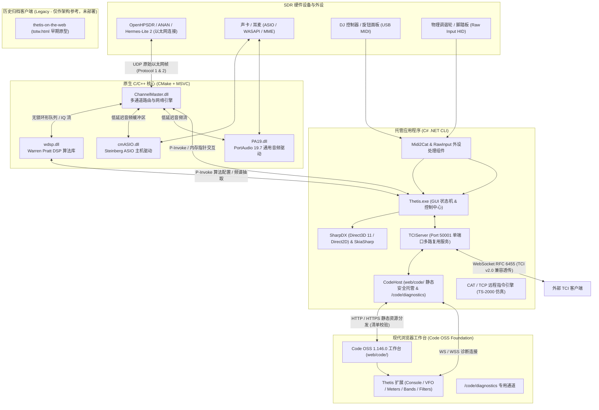

# Thetis-Web 架构与模块体系说明文档 (STRUCTURE.md)

本文档对 Thetis-Web 项目的代码组织结构、核心大模块划分、各模块所依赖的系统 API 与底层库接口，以及端到端数据流与控制流进行深度技术剖析。

> [!IMPORTANT]
> **架构基准演进声明：旧版 WebUI 已正式归档为 Legacy 仅作参考**
> 
> 当前浏览器端运行时**唯一正式部署**的架构为 **Thetis Code OSS Foundation (Stage 1)**：资源位于 [Project Files/bin/x64/Release/web/code/](file:///d:/workspace/Thetis/Project%20Files/bin/x64/Release/web/code/)，根入口 `/` 自动重定向至 `/code/`，由 [CodeHost.cs](file:///d:/workspace/Thetis/Project%20Files/Source/Console/Hosting/CodeHost.cs) 与 [TCIServer.cs](file:///d:/workspace/Thetis/Project%20Files/Source/Console/TCIServer.cs) 在单端口 50001 提供 HTTP/WebSocket 多路复用服务。
> 
> 本文档中所有关于早期子模块 [thetis-on-the-web](file:///d:/workspace/Thetis/submodules/thetis-on-the-web/) (TOTW / `totw.html`) 的描述均已正式进入 **Legacy 状态**，仅作为早期原型设计与历史算法对照参考，**不再参与任何构建、测试与运行时部署**。

---

## 1. 总体架构拓扑 (System Topology)

Thetis-Web 采用分层解耦的现代化混合架构设计：
- **底层原生层 (Native Core, C99 / C++17)**：负责纳秒级时间敏感的数字信号处理 (DSP)、无锁环形缓冲队列、超低延迟音频硬件驱动 (ASIO / PortAudio / WDM-KS / WASAPI) 以及高吞吐 UDP 网络通信 (OpenHPSDR 硬件交互)。
- **托管控制层 (Managed Core, C# / .NET Framework 4.8 on Roslyn)**：负责 Windows Forms 桌面交互、DirectX 11 / Direct2D 硬件加速频谱瀑布流渲染、电台状态机维护、CAT 指令解析、MIDI 映射及单一端口网络多路复用。
- **现代浏览器工作台层 (Code OSS Foundation, TypeScript / Web Standards)**：固定版本的上游 Code OSS 1.146.0 提供原生工作台，父仓库独立维护的 Thetis 扩展与嵌入宿主提供模块化电台视图、合成 Console 控制台、皮肤与 `/code/diagnostics` 专用通道。托管层通过单端口 50001 的 [CodeHost.cs](file:///d:/workspace/Thetis/Project%20Files/Source/Console/Hosting/CodeHost.cs) 统一托管。
- **历史归档 WebUI (Legacy - Reference Only)**：早期 [thetis-on-the-web](file:///d:/workspace/Thetis/submodules/thetis-on-the-web/) 作为历史源码保留，不部署至生产运行时。



---

## 2. 核心大模块详细剖析

### 2.1 原生 DSP 核心模块 (`wdsp.dll`)

- **源码路径**：[Project Files/Source/wdsp/](file:///d:/workspace/Thetis/Project%20Files/Source/wdsp/)
- **开发语言**：C99
- **模块职责**：
  Warren Pratt (NR0V) 编写的高性能数字信号处理库。负责电台全通带及各接收机/发射机通道的基础算法运算。
- **内部核心组件**：
  - `RXA.c` / `TXA.c`：接收 (RX) 与发射 (TX) 算法流水线编排；
  - `bandpass.c` / `cfir.c` / `icfir.c` / `fir.c` / `iir.c`：重叠保留法 (Overlap-Save) 快速卷积滤波器、多抽样率抽取与插值 FIR/IIR 滤波；
  - `wcpAGC.c`：Warren Pratt 自动增益控制，支持针对脉冲噪声优化的可变时间常数衰减；
  - `anr.c` / `anf.c`：自适应谱线增强 (LMS) 与自适应陷波算法；
  - `nob.c` / `nobII.c` / `snb.c` / `nbp.c`：时域多阶段脉冲噪声消除器 (Noise Blanker)；
  - `rnnr.c` / `sbnr.c`：现代深度学习与频谱减算法，集成 RNNoise 循环神经网络降噪与 SpecBleach 谱白化降噪；
  - `ammod.c` / `amd.c` / `fmmod.c` / `fmd.c` / `gen.c`：AM、SAM（同步检波）、FM、SSB、CW 调制解调器；
  - `iqc.c` / `calcc.c`：硬件正交平衡校准 (IQ Imbalance Correction) 与相位/幅度校准；
  - `analyzer.c` / `wisdom.c`：高动态范围频谱分析仪与 FFTW 执行计划缓存管理。
- **调用的系统与第三方库接口**：
  - **`libfftw3-3.dll` / `fftw3.h`**：调用 64 位 FFTW3 库执行 1D 快速傅里叶变换、频域卷积以及 Wisdom 计算计划的本地持久化；
  - **`rnnoise.dll`**：调用递归神经网络降噪动态库，载入预训练权重 (`rnnoise_weights_large.bin`, `rnnoise_weights_small.bin`)；
  - **`specbleach.dll`**：频谱漂白/自适应谱减运算；
  - **`avrt.lib` (Windows MMCSS)**：调用 Windows Multimedia Class Scheduler Service (`AvSetMmThreadCharacteristics`) 将 DSP 线程提升至 Pro Audio 实时优先级别；
  - **C 标准数学库 (`math.h`)**：利用硬件 AVX/FMA 指令集进行浮点运算。

---

### 2.2 原生通道路由与网络引擎 (`ChannelMaster.dll`)

- **源码路径**：[Project Files/Source/ChannelMaster/](file:///d:/workspace/Thetis/Project%20Files/Source/ChannelMaster/)
- **开发语言**：C99
- **模块职责**：
  全系统的通道总调度枢纽。负责在多物理接收通道 (DDC)、发射通道 (DUC)、外部音频设备与托管层之间执行零拷贝/极低延迟的数据分发，并直接驱动 OpenHPSDR 硬件的以太网网络通信。
- **内部核心组件**：
  - `cmaster.c`：通道管理主入口，维护无线电拓扑结构、抽样率转换状态；
  - `network.c` / `netInterface.c` / `networkproto1.c`：OpenHPSDR Protocol 1 与 Protocol 2 网络堆栈，处理原始 UDP 套接字收发、高速 IQ 分包组装、序列号纠错与丢包统计；
  - `ring.c` / `pipe.c` / `cmbuffs.c` / `obbuffs.c`：针对多核并发设计的原子级无锁环形队列 (Lockless Ring Buffer) 与弹性管道，解耦网络收发线程、DSP 计算线程与音频输出线程；
  - `cmasio.c`：与 ASIO 主机驱动层的原生数据缓冲交互；
  - `ivac.c`：虚拟音频电缆 (VAC) 接口支持；
  - `sidetone.c`：纳秒级低抖动 CW 侧音合成器；
  - `vox.c`：高速语音控制发射 (VOX) 与 LookAhead 前瞻延迟队列；
  - `tci.c`：底层原生 TCI 音频与 IQ 数据分发挂钩。
- **调用的系统与第三方库接口**：
  - **`ws2_32.lib` (Windows Sockets 2)**：高性能非阻塞 UDP 套接字通信，支持 48kHz 到 1.536MHz 宽带 IQ 原始射频流的吞吐；
  - **`avrt.lib`**：网络 I/O 线程 MMCSS 实时调度优先级绑定；
  - **`PA19.dll`**：调用 PortAudio 原生流接口；
  - **`cmASIO.dll`**：调用自定义 ASIO 主机驱动接口；
  - **`wdsp.dll`**：向 WDSP 压入各通道 IQ 样本并取出解调后音频。

---

### 2.3 原生音频驱动层 (`cmASIO.dll` 与 `PA19.dll`)

#### `cmASIO.dll` (ASIO 主机驱动)
- **源码路径**：[Project Files/Source/cmASIO/](file:///d:/workspace/Thetis/Project%20Files/Source/cmASIO/)
- **开发语言**：C++17
- **模块职责**：
  封装专业专业声卡厂商提供的 Steinberg ASIO 驱动接口，消除 Windows 系统音频混音器的重采样与缓冲区引入的延迟。
- **调用的系统与第三方库接口**：
  - **Steinberg ASIO SDK 2.3.3**：实现 `asio.cpp`、`asiodrivers.cpp`、`asiolist.cpp`；
  - **`ole32.lib` (Windows COM)**：调用 `CoInitialize`、`CoCreateInstance` 根据 CLSID 创建第三方声卡 ASIO COM 组件；
  - **`advapi32.lib`**：查询注册表项 `HKEY_LOCAL_MACHINE\SOFTWARE\ASIO` 动态发现系统中已安装的 ASIO 驱动。

#### `PA19.dll` (PortAudio v19.7)
- **源码路径**：[Project Files/lib/portaudio-19.7.0/](file:///d:/workspace/Thetis/Project%20Files/lib/portaudio-19.7.0/) 及 [cmake/PA19.cmake](file:///d:/workspace/Thetis/cmake/PA19.cmake)
- **开发语言**：C99 / C++
- **模块职责**：
  通用跨平台音频抽象接口。为非 ASIO 专业声卡（板载声卡、USB 麦克风、蓝牙耳机等）提供全套低延迟驱动接入方案。
- **支持的宿主音频接口与系统库**：
  - **Windows WDM-KS (`ksuser.lib`, `setupapi.lib`)**：Windows 驱动模型内核流（Kernel Streaming），绕过驱动堆栈直连声卡硬件；
  - **Windows WASAPI (`ole32.lib`, `uuid.lib`)**：现代 Windows 音频会话 API（支持 Exclusive 独占模式与 Shared 共享模式）；
  - **Windows MME (`winmm.lib`)**：传统 Windows 平台标准音频波形接口；
  - **DirectSound (`dsound`)**：DirectSound 硬件缓冲支持。

---

### 2.4 托管核心与主界面 (`Thetis.exe` / `Console`)

- **源码路径**：[Project Files/Source/Console/](file:///d:/workspace/Thetis/Project%20Files/Source/Console/)
- **开发语言**：C# (.NET Framework 4.8, 基于现代 Roslyn 编译器)
- **模块职责**：
  系统状态总控、用户界面呈现、外设联动以及对原生动态库的编排控制。
- **内部主要子系统**：
  1. **主控制中心 (`console.cs`)**：
     协调全生命周期事件、电台上下电逻辑、频段预设栈 (BandStack)、滤波器带宽切换、天线继电器分配等。
  2. **硬件加速显示流水线 (`display.cs`, `PanDisplay.cs`, `wbDisplay.cs`)**：
     驱动频谱视图 (Panadapter)、瀑布图 (Waterfall)、全景宽带视图 (Wideband Display) 以及数字式/模拟指针式 S 表头。
  3. **硬件发现与控制子系统 (`HPSDR/`)**：
     - `clsRadioDiscovery.cs`：局域网广播搜寻 Metis / Hermes / ANAN 硬件；
     - `NetworkIO.cs` / `NetworkIOImports.cs`：托管与原生通信桥梁；
     - `Alex.cs` / `Penny.cs`：电台前端带通滤波板与高线性功放偏置控制。
  4. **指令控制子系统 (`CAT/`)**：
     - `CATParser.cs` / `CATCommands.cs`：Kenwood TS-2000 兼容指令解析器；
     - `TCPIPcatServer.cs`：支持通过 TCP 本地或远程套接字连接 WSJT-X、JTDX、N1MM Logger、Log4OM 等数字日志软件；
     - `SDRSerialPortII.cs`：虚拟串口与物理串口数据流处理。
  5. **CW 莫尔斯电码引擎 (`CW/`)**：
     - `cwkeyer.cs` / `cwx.cs` / `CWInput.cs`：Iambic A/B 自动电键、手动电键、键盘文本自动拍发与即时防抖。
  6. **Andromeda 外设适配器 (`Andromeda/`)**：
     - 专有硬件面板控制接口，驱动外部旋转编码器、波段按键矩阵与 OLED 信息显示屏。
  7. **全局配置与校准系统 (`setup.cs`)**：
     - 提供数百项收发校准、网络缓冲区大小设置、VAC 通道重映射及显示调优界面。
- **调用的系统与第三方库接口**：
  - **`SharpDX` (Direct3D 11, Direct2D, DXGI)**：调用 GPU 硬件管线直接渲染频谱网格、高帧率色彩渐变瀑布图与滤波带覆盖层；
  - **`SkiaSharp` / `Svg`**：矢量图元绘制、高动态仪表盘平滑抗锯齿渲染；
  - **`NAudio` (`NAudio.WinMM`, `NAudio.Midi`, `NAudio.Wasapi`)**：Windows 音频与 MIDI 事件捕获；
  - **`FTDI2XX.dll`**：通过 FTDI D2XX 驱动与外部 USB-串口转换芯片高速交互；
  - **`WindowsFirewallHelper`**：自动向 Windows Defender 防火墙注册规则，放行本程序的 UDP 数据包监听；
  - **Win32 底层 API (`user32.dll`, `kernel32.dll`, `gdi32.dll`, `dwmapi.dll`, `shcore.dll`)**：高 DPI 感知适配、窗口 DWM 半透明特效、多媒体高精度计时器 (`timeBeginPeriod`, `QueryPerformanceCounter`)；
  - **`System.Reactive` (Rx.NET)**：响应式事件流处理。

---

### 2.5 单端口 Web 服务与协议多路复用器 (`TCIServer.cs` 与 `CodeHost.cs`)

- **源码路径**：[Project Files/Source/Console/TCIServer.cs](file:///d:/workspace/Thetis/Project%20Files/Source/Console/TCIServer.cs)、[Project Files/Source/Console/Hosting/CodeHost.cs](file:///d:/workspace/Thetis/Project%20Files/Source/Console/Hosting/CodeHost.cs)
- **开发语言**：C# (.NET Framework 4.8 / Roslyn)
- **模块职责**：
  解决传统 SDR 方案需要双端口（一个跑 Web 页面、一个跑网络控制）带来的部署混乱。通过端口 50001 的流量特征识别与请求路径路由，在单端口内原生实现 HTTP/HTTPS 静态资源安全分流、RFC 6455 WebSocket 协议升级、`/code/diagnostics` 专用通道及传统 TCI v2.0 电台数据透传。
- **运行机制**：
  - **静态资源安全分发 ([CodeHost.cs](file:///d:/workspace/Thetis/Project%20Files/Source/Console/Hosting/CodeHost.cs))**：
    监听客户端 TCP 连接后读取 HTTP 请求行。标准 `GET /code/*` 请求从运行目录的 `web/code/` 读取并返回经过资产清单校验的 Code OSS 静态文件与 Thetis 扩展包。内置防路径穿越、严格 MIME 类型映射及大文件流式传输，且根路径 `/` 自动重定向至 `/code/`；
  - **专用诊断 WebSocket (/code/diagnostics)**：
    前端扩展持有独立诊断连接，直接与 C# 宿主进行带序列号的心跳和非电台诊断回显交互，无需创建电台客户端；
  - **TCI v2.0 协议全双工升级器 ([TCIServer.cs](file:///d:/workspace/Thetis/Project%20Files/Source/Console/TCIServer.cs))**：
    若检测到外部 TCI 客户端的 `Upgrade: websocket` 握手请求，则进行 SHA-1 握手秘钥计算并返回 101 Switching Protocols 响应，转入全双工二进制协议模式，支持与 Log4OM、WSJT-X 等外部软件的高速通信。
- **调用的系统与库接口**：
  - `System.Net.Sockets.TcpListener` / `TcpClient` / `NetworkStream`；
  - `System.Security.Cryptography.SHA1`。

---

### 2.6 [Legacy / 历史参考] 早期嵌入式 WebUI 客户端 (`thetis-on-the-web` / TOTW)

> [!NOTE]
> **本模块已正式进入 Legacy 历史归档状态**。
> 其源码保留在 [submodules/thetis-on-the-web/](file:///d:/workspace/Thetis/submodules/thetis-on-the-web/)，仅作为早期单文件 Web 前端原型、Canvas 2D 瀑布流绘制与 Web Audio API 音频实验的算法参考。
> 当前生产构建流水线与发布包**不再编译或部署该模块**。

- **源码路径**：[submodules/thetis-on-the-web/](file:///d:/workspace/Thetis/submodules/thetis-on-the-web/)
- **开发语言**：Vanilla ES6 JavaScript, HTML5, CSS3 (零第三方 npm 构建依赖)
- **历史前端架构**：
  - **Canvas 2D 硬件加速频谱瀑布流**：前端在 Web Worker / 主线程中接收 Float32 格式的时域 IQ 样本，执行客户端 4096 点 FFT 计算与 Blackman-Harris 加窗运算，以 60 FPS 在 HTML5 Canvas 上绘制高清晰度频谱与多色彩瀑布图；
  - **Web Audio API 实验性音频流转**：
    - 接收方向：利用 `AudioContext` 与音频工作流缓冲区解码接收到的 TCI 音频帧，驱动设备扬声器低延迟播放；
    - 发射方向：调用 `navigator.mediaDevices.getUserMedia` 获取浏览器麦克风输入，转换并重采样为 48kHz Float32 PCM，封装入 TCI 二进制数据帧送入 Thetis 进行射频调制；
  - **DX Cluster 动态图层**：接入 Spothole API，将全球电台呼叫点 (Spots) 实时叠加显示于频谱刻度尺上方。

---

### 2.7 现代 Code OSS 浏览器工作台 (Thetis Code OSS Foundation & Extension)

- **源码路径**：[ui/](file:///d:/workspace/Thetis/ui/)、[submodules/vscode/](file:///d:/workspace/Thetis/submodules/vscode/) (镜像 Fork 至 [https://github.com/baiyunquan/vscode.git](https://github.com/baiyunquan/vscode.git)，分支 `thetis-pinned`)
- **运行时部署目录**：[Project Files/bin/x64/Release/web/code/](file:///d:/workspace/Thetis/Project%20Files/bin/x64/Release/web/code/)
- **开发语言**：TypeScript, CSS / Less, HTML
- **模块架构与职责**：
  1. **Code OSS 1.146.0 基础底座**：
     基于经过资格验证的上游固定版本构建，提供原生的工作区容器、布局管理器、侧边栏 (Activity Bar)、可折叠视图树 (TreeView)、Webview 视图容器 (WebviewView)、标签页拆分与 IndexedDB 布局持久化存储机制；
  2. **Thetis 宿主嵌入层 ([ui/code-oss-host/](file:///d:/workspace/Thetis/ui/code-oss-host/))**：
     父仓库自主拥有的嵌入引导程序，负责装配工作台启动参数、挂载 Thetis 专用扩展、适配安全上下文与处理服务工作线程 (Service Worker) 控制生命周期；
  3. **Thetis 核心扩展 ([ui/thetis-extension/](file:///d:/workspace/Thetis/ui/thetis-extension/))**：
     - 提供 Operate、Receiver Controls、Meters、Bands、Modes、Filters、Memories、Audio、RF、Display & Skins、Setup 等独立电台面板；
     - 实现合成 Console 主电台编辑器视窗，支持 Classic 与 Midnight 两套无线电皮肤无缝切换；
     - 维护与后端 [CodeHost.cs](file:///d:/workspace/Thetis/Project%20Files/Source/Console/Hosting/CodeHost.cs) 的 `/code/diagnostics` 专用通信通道；
  4. **全自动资产安全清单**：
     由 [build.mjs](file:///d:/workspace/Thetis/ui/build.mjs) 在打包阶段静态生成 `web/code/asset-manifest.json`，确保运行时仅向浏览器分发经由数字指纹核验的安全静态资产。

---

### 2.8 扩展输入支持模块 (`Midi2Cat` 与 `RawInput`)

#### `Midi2Cat`
- **源码路径**：[Project Files/Source/Midi2Cat/](file:///d:/workspace/Thetis/Project%20Files/Source/Midi2Cat/)
- **开发语言**：C# (.NET 4.8)
- **模块职责**：
  将外部标准 USB MIDI 设备（如 Hercules DJ 控制台、Behringer 旋钮盘）的 Control Change (CC)、Note-On/Off 消息映射为 Thetis 内部调谐、增益、静音及按键指令。
- **依赖接口**：`NAudio.Midi`、Windows Multimedia API。

#### `RawInput`
- **源码路径**：[Project Files/Source/RawInput/](file:///d:/workspace/Thetis/Project%20Files/Source/RawInput/)
- **开发语言**：C# (.NET 4.8)
- **模块职责**：
  基于 Win32 原始输入模型，直接从 Windows 输入子系统获取特定外设（如专用飞轮、Shuttle 调谐轮）的细分移动量，不受窗口焦点切换的影响。
- **依赖接口**：`user32.dll` (`RegisterRawInputDevices`, `GetRawInputData`, `WM_INPUT`)。

---

## 3. 系统与第三方库接口矩阵 (Interface Matrix)

下表全面汇总了各模块与其消费的系统 API / 第三方库接口的对应关系：

| 模块分类 | 目标组件 | 消费的系统 API / 第三方库 | 关键接口 / 标头文件 | 核心技术功用 |
| :--- | :--- | :--- | :--- | :--- |
| **原生 DSP** | `wdsp.dll` | **FFTW3** (`libfftw3-3.dll`) | `fftw3.h`, `fftw_plan`, `fftw_execute` | 1D 高速傅里叶变换、频域卷积与 Wisdom 缓存 |
| | | **RNNoise** (`rnnoise.dll`) | `rnnoise.h`, `rnnoise_process_frame` | 基于循环神经网络的 AI 语音降噪 |
| | | **SpecBleach** (`specbleach.dll`) | `specbleach.h` | 自适应频谱减法与自适应滤波 |
| | | **Windows MMCSS** (`avrt.lib`) | `avrt.h`, `AvSetMmThreadCharacteristics` | 提升 DSP 计算线程为 Windows Pro Audio 实时优先级 |
| | | **C Runtime Math** | `<math.h>` (AVX2 / FMA) | 底层矢量化浮点信号滤波与变换运算 |
| **原生路由网络** | `ChannelMaster.dll` | **WinSock 2** (`ws2_32.lib`) | `winsock2.h`, `socket`, `sendto`, `recvfrom` | 非阻塞 UDP 套接字高速收发 OpenHPSDR 硬件帧 |
| | | **Windows MMCSS** (`avrt.lib`) | `avrt.h`, `AvSetMmThreadCharacteristics` | 保证网络 I/O 线程零丢包与超低时延调度 |
| | | **原子并发** | Windows Interlocked 指令 | 多线程多通道零拷贝无锁环形缓冲区数据同步 |
| **原生音频驱动** | `cmASIO.dll` | **Steinberg ASIO SDK 2.3.3** | `asio.h`, `asiodrivers.h` | 专业声卡原生低延迟 ASIO 驱动通信 |
| | | **Windows COM** (`ole32.lib`) | `combaseapi.h`, `CoCreateInstance` | 实例化 ASIO 设备的 COM 对象句柄 |
| | | **Windows Registry** (`advapi32.lib`) | `winreg.h`, `RegOpenKeyEx` | 查询系统注册表已安装的专业 ASIO 驱动列表 |
| | `PA19.dll` | **Windows WDM-KS** (`ksuser.lib`) | `ks.h`, `setupapi.h` | 绕过系统混音器内核直连音频硬件接口 |
| | | **Windows WASAPI** (`ole32.lib`) | `audioclient.h`, `mmdeviceapi.h` | 现代低延迟独占/共享音频端点管理 |
| | | **Windows MME** (`winmm.lib`) | `mmsystem.h`, `waveInOpen`, `waveOutOpen` | 传统通用音频设备兼容支持 |
| **托管核心 GUI** | `Thetis.exe` | **SharpDX** (DirectX 11 / 2D) | `SharpDX.Direct3D11`, `SharpDX.Direct2D1` | GPU 硬件加速实时渲染频谱网格与高帧率瀑布流 |
| | | **SkiaSharp & Svg** | `SkiaSharp.dll`, `Svg.dll` | 现代矢量图元绘制与高动态 S 表头平滑绘制 |
| | | **NAudio** | `NAudio.Midi`, `NAudio.Wasapi` | 辅助音频设备交互与 MIDI 消息流解析 |
| | | **Win32 OS 底层** | `user32.dll`, `gdi32.dll`, `dwmapi.dll` | 高 DPI 适配、DWM 渲染合成、窗口消息钩子 |
| | | **高精度时钟** | `kernel32.dll`, `winmm.dll` | `timeBeginPeriod(1)`, `QueryPerformanceCounter` |
| | | **Windows 防火墙** | `WindowsFirewallHelper` | 自动化放行 OpenHPSDR 端口与 TCI 监听端口 |
| | | **FTDI 硬件** | `FTDI2XX.dll` | 物理 USB-串口/FIFO 控制器直连通信 |
| **Web 服务** | `TCIServer.cs` | **.NET Sockets** | `System.Net.Sockets.TcpListener` | 50001 端口单端口 HTTP/WebSocket 多路复用 |
| | | **.NET 加密库** | `System.Security.Cryptography.SHA1` | RFC 6455 Sec-WebSocket-Accept 握手校验 |
| | `CodeHost.cs` | **.NET HTTP/TLS** | `HttpListener`, `SslStream` | `web/code/` 静态安全托管、资产清单校验与 `/code/diagnostics` 诊断通道 |
| **现代网页前端** | `ui/thetis-extension` | **Code OSS 1.146.0** | `vscode.window`, `WebviewViewProvider` | 现代化原生电台工作台、模块化视图与 Classic/Midnight 皮肤 |
| | `ui/code-oss-host` | **Web Standards** | `ServiceWorker`, `IndexedDB` | 前端宿主引导、跨引擎控制器适配与布局状态持久化 |
| **[Legacy/参考]** | `thetis-on-the-web` | **HTML5 Canvas 2D** | `CanvasRenderingContext2D` | 早期单文件原型 4096 点 FFT 瀑布流（源码保留仅作参考） |
| | | **Web Audio API** | `AudioContext`, `getUserMedia` | 早期浏览器麦克风采集与音频播放原型（已停止部署） |
| **外设接口** | `RawInput.dll` | **Win32 Raw Input** (`user32.dll`) | `RegisterRawInputDevices`, `GetRawInputData` | 获取调谐飞轮与外部无焦点输入设备的原始位移 |

---

## 4. 端到端核心业务数据流

### 4.1 接收 (RX) 数据流全链路
```text
[以太网硬件 / 射频天线]
       │ (1) 原始高频 UDP 采样包 (48k~1536k 速率)
       ▼
[ChannelMaster.dll : network.c] ──── (纠错、解包、写入无锁环形队列)
       │
       ▼
[wdsp.dll : RXA.c]
       ├─► [FFTW3] 频域卷积带通滤波 (cfir.c / bandpass.c)
       ├─► [RNNoise / SpecBleach] 神经网络降噪 & 谱减降噪
       ├─► [wcpAGC.c] 自动增益控制与峰值限幅
       └─► [amd.c / fmd.c / gen.c] 解调为基带音频 (Float32 / 48kHz)
       │
       ├──► (A) 写入 [cmASIO.dll] / [PA19.dll] ──► [本地耳机 / 扬声器]
       │
       ├──► (B) 通过 [analyzer.c] 计算 FFT 幅度 ──► [Thetis.exe : SharpDX GPU] ──► [桌面 Panadapter 瀑布流]
       │
       ├──► (C) [现代工作台] 通过 [CodeHost.cs] (:50001/code/) ──► [Code OSS Thetis 扩展工作台] (诊断通道与合成面板)
       │
       └──► (D) [Legacy 历史原型参考] 早期通过 [TCIServer.cs] WebSocket ──► [totw.html : Web Audio API & Canvas] (已停止部署)
```

### 4.2 发射 (TX) 数据流全链路
```text
[麦克风输入] ──► 本地麦克风 (PA19 / ASIO) [现代 Code OSS 浏览器真实音频流转规划在后续阶段接入]
       │         (注：历史早期原型中的 totw.html Web Audio 麦克风流转仅保留源码作参考)
       ▼
[Thetis.exe / TCIServer.cs] ──► (抽取并归一化为 48kHz PCM 样本)
       │
       ▼
[ChannelMaster.dll : vox.c] ──► (VOX 语音检测与 LookAhead 队列延迟)
       │
       ▼
[wdsp.dll : TXA.c]
       ├─► [compress.c / dexp.c] 语音压限器与向下扩展器
       ├─► [eq.c] 发射 10 段均衡器
       ├─► [ammod.c / fmmod.c / gen.c] 调制为 IQ 发射基带信号
       └─► [calcc.c / iqc.c] IQ 载波抑制与相位/幅度平衡
       │
       ▼
[ChannelMaster.dll : network.c] ──► (组装 OpenHPSDR 发射控制帧与 IQ 数据包)
       │
       ▼ (以太网 UDP 发送)
[OpenHPSDR 硬件 DAC / 功放 (Penny / Alex)] ──► [天线射频发射]
```

---

## 5. 项目源码与工程布局图谱

```text
Thetis/
├── .github/
│   └── workflows/
│       └── windows-build.yml                # GitHub Actions 云端 CI 构建流水线 (单 Job 三阶段)
├── .vscode/                                 # VS Code 工程配置文件
│   ├── tasks.json                           # 声明式构建任务 (Ctrl+Shift+B)
│   ├── launch.json                          # 调试配置 (C# / C++ 混合断点与 Demo 启动)
│   ├── settings.json                        # 工作区规则与文件排除
│   └── extensions.json                      # 推荐开发插件
├── cmake/                                   # CMake 辅助构建模块
│   └── PA19.cmake                           # PortAudio 19 构建脚本
├── CMakeLists.txt                           # 原生根构建定义 (MSVC + Ninja)
├── CMakePresets.json                        # 标准 CMake 预设配置
├── Directory.Build.props                    # Roslyn 编译器常驻编译服务优化配置
├── build.ps1                                # PowerShell 一键自动化构建脚本
├── build.bat                                # CMD 批处理一键构建脚本
├── AGENTS.md                                # AI 编程助手架构契约与行为准则
├── STRUCTURE.md                             # 项目架构与大模块技术规范 (本文档)
├── ReadMe.md                                # 项目用户与开发者指南
├── BUILD.md                                 # 编译构建、测试与多启动模式指南
│
├── ui/                                      # [现代工作台] Thetis Code OSS 前端工程
│   ├── code-oss-host/                       # 嵌入宿主引导代码与服务工作线程适配器
│   ├── thetis-extension/                    # Thetis 专用电台工作台扩展 (Console / Panels)
│   ├── baseline/                            # 布局状态机与证书凭据测试基准
│   ├── scripts/                             # 测试、驱动与资格检查自动化脚本
│   ├── build-code-web.ps1                   # 上游 Code OSS 浏览器包预编译与缓存脚本
│   ├── build-ui.ps1                         # Thetis 宿主与扩展构建打包脚本
│   └── stage-code-web.ps1                   # 部署资源至运行目录脚本
│
├── Project Files/
│   ├── lib/                                 # 第三方预编译依赖库
│   │   ├── fftw_x64/                        # FFTW3 64位动态库与静态库
│   │   ├── NR_Algorithms_x64/               # RNNoise / SpecBleach 原生降噪库与模型权重
│   │   ├── portaudio-19.7.0/                # PortAudio 跨平台音频库源码
│   │   ├── SkiaSharp/                       # Skia 绘图引擎本地 DLL
│   │   └── Thetis-resources/                # 基础资源与运算常数
│   │
│   ├── Source/
│   │   ├── wdsp/                            # [模块 1] Warren Pratt DSP 核心算法库 (C99)
│   │   ├── ChannelMaster/                   # [模块 2] 多通道路由与 HPSDR 网络引擎 (C99)
│   │   ├── cmASIO/                          # [模块 3] Steinberg ASIO 驱动集成包装 (C++17)
│   │   ├── Console/                         # [模块 4 & 5] Thetis 托管层应用程序 (C# .NET 4.8)
│   │   │   ├── Andromeda/                   # 物理专用控制台驱动
│   │   │   ├── CAT/                         # TS-2000 CAT 指令仿真与 TCP 服务器
│   │   │   ├── CW/                          # CW 自动键与时序调度
│   │   │   ├── Hosting/                     # CodeHost 单端口静态资产与诊断通信托管
│   │   │   ├── HPSDR/                       # OpenHPSDR 硬件通信与设备探测
│   │   │   ├── Memory/                      # 频段记忆与 DX 呼叫点存储
│   │   │   ├── TCIServer.cs                 # 单端口 50001 HTTP/WebSocket 多路复用服务
│   │   │   └── Thetis.csproj                # C# 主工程定义
│   │   ├── Midi2Cat/                        # [模块 7] MIDI 旋钮面板 CAT 映射器 (C#)
│   │   ├── RawInput/                        # [模块 7] Win32 Raw Input 底层输入组件 (C#)
│   │   └── packages/                        # NuGet 还原依赖包 (NAudio, SharpDX 等)
│   │
│   └── bin/x64/Release/                     # 最终打包运行时目录 (执行根目录)
│       ├── Thetis.exe                       # 主可执行文件
│       ├── ChannelMaster.dll                # 原生通道路由库
│       ├── wdsp.dll                         # 原生 DSP 库
│       ├── cmASIO.dll                       # 原生 ASIO 驱动库
│       ├── PA19.dll                         # 原生 PortAudio 驱动库
│       ├── libfftw3-3.dll                   # FFT 依赖库
│       ├── rnnoise.dll                      # 神经网络降噪依赖库
│       ├── web/                             # Web 资源托管根目录
│       │   └── code/                        # Code OSS 运行时、宿主与扩展资产清单
│       └── Skins/                           # 皮肤外观配置目录
│
└── submodules/
    ├── vscode/                              # [活跃子模块] Code OSS 1.146.0 (Fork: baiyunquan/vscode)
    └── thetis-on-the-web/                   # [Legacy / 历史参考] 早期原型源码 (未部署)
        ├── totw.html                        # 历史单文件 WebUI 客户端原型
        └── website/                         # 历史拆分源码 (CSS/JS)
```


---

## 6. Windows Forms 界面窗口全景剖析 (WinForms Catalog)

Thetis 的桌面图形界面基于经典高效的 Windows Forms (WinForms) 技术构建，采用双缓冲防撕裂渲染 (`Common.DoubleBufferAll`)、动态 DPI 缩放适配 (`clsDPISafeTools`)、DWM 桌面窗口合成特效与自定义矢量皮肤系统 (`clsThetisSkinService`)。

经对代码库的完整遍历检索，项目中共有 **56 个独立的 WinForms 窗口类**（继承自 `System.Windows.Forms.Form`）。按业务功能体系划分为以下十大类别：

---

### 6.1 主控制台与程序生命周期窗口 (Main Console & Lifecycle)

1. **`Console`** ([console.cs](file:///d:/workspace/Thetis/Project%20Files/Source/Console/console.cs), [Andromeda.cs](file:///d:/workspace/Thetis/Project%20Files/Source/Console/Andromeda/Andromeda.cs))
   - **窗口职责**：Thetis 的核心主控制台窗口，也是整个软件的启动和运行总控枢纽。
   - **核心功能**：
     - 呈现双 VFO (VFO A / VFO B) 频率数字滚轮与频率微调刻度；
     - 集成 SharpDX 硬件加速渲染的全景频谱图 (Panadapter) 与高帧率色彩瀑布流 (Waterfall)；
     - 调制模式切换 (LSB, USB, DSB, CWL, CWU, FMN, AM, SAM, SPEC, DIGL, DIGU, DRM)；
     - 接收滤波器通带快速切换按键 (6K, 4K, 2.8K, 2.4K, 2.1K, 1.8K, 1.0K, 500, 250, 100, 50Hz, VAR1, VAR2)；
     - 收发状态控制 (MOX 手动发射, VOX 声控发射, TUNE 调谐载波输出, MUT 静音, DUP 全双工监听)；
     - 射频增益 (ATT/Preamp)、音频音量 (AF)、驱动功率 (Drive)、AGC 特性 (Off/Long/Slow/Med/Fast/Custom)；
     - 模拟指针式与数字式 S-Meter / 功率表 / ALC 动态表头；
     - 协调所有子窗口的停靠、弹出与隐藏。
2. **`Splash`** ([splash.cs](file:///d:/workspace/Thetis/Project%20Files/Source/Console/splash.cs))
   - **窗口职责**：启动初始画面闪屏 (Splash Screen)。
   - **核心功能**：在后台加载大型依赖库、探测硬件网络、初始化 Direct3D 设备与计算 FFTW Wisdom 计划期间显示进度条与当前加载阶段提示，防止用户误判为程序卡死。
3. **`ShutdownForm`** ([ShutdownForm.cs](file:///d:/workspace/Thetis/Project%20Files/Source/Console/ShutdownForm.cs))
   - **窗口职责**：安全关闭等待窗口。
   - **核心功能**：程序退出时显示平滑注销进度，确保依次完成：保存当前电台频段配置到 XML/数据库、停止发射状态机、释放 ASIO 与 PortAudio 音频句柄、注销 UDP 接收套接字并停止 MMCSS 线程调度。
4. **`frmAbout`** ([frmAbout.cs](file:///d:/workspace/Thetis/Project%20Files/Source/Console/frmAbout.cs))
   - **窗口职责**：关于信息视窗 (About Thetis)。
   - **核心功能**：显示当前程序版本号、修订版 Git 提交标识、编译架构 (x64)、开源许可协议 (GPL v2 及双重许可声明) 以及 OpenHPSDR、TAPR、Warren Pratt (NR0V)、Richie (MW0LGE) 等核心贡献者致谢列表。
5. **`Progress`** ([progress.cs](file:///d:/workspace/Thetis/Project%20Files/Source/Console/progress.cs))
   - **窗口职责**：通用模态进度条对话框。
   - **核心功能**：为耗时操作（如固件检测、大批量数据迁移、滤波表重计算）提供带有取消按钮的百分比进度指示。
6. **`InputBox`** ([InputBox.cs](file:///d:/workspace/Thetis/Project%20Files/Source/Console/InputBox.cs))
   - **窗口职责**：轻量级单行文本输入对话框。
   - **核心功能**：在用户创建新预设、重命名波段、修改信道标签或自定义快捷键时获取用户输入。

---

### 6.2 全局系统与硬件设置窗口 (Global Setup & Radio Configuration)

7. **`Setup`** ([setup.cs](file:///d:/workspace/Thetis/Project%20Files/Source/Console/setup.cs))
   - **窗口职责**：全局综合参数配置主对话框 (Thetis Setup)。
   - **核心功能**：包含数十个功能分页，为 Thetis 最庞大的设置中枢：
     - **General**：硬件型号选择 (Hermes, ANAN-10/100/200/7000/8000 等)、校准常数、ADC/DAC 时钟基准微调；
     - **Audio**：主音频驱动引擎切换 (cmASIO / PortAudio / MME / WASAPI)、缓冲区采样点大小 (Sample Rate & Buffer Size) 调整、VAC (虚拟音频电缆) 路由重定向；
     - **Display**：DirectX 11 垂直同步、帧率限制、瀑布流渐变色谱映射表、频谱动态范围 (Min/Max dBm)；
     - **DSP**：WDSP 算法参数、NR/ANF 自适应滤波阶数、AGC 衰减斜率与挂起门限；
     - **Transmit**：PA 偏置电压调谐、10 段发射均衡器、微麦克风前置放大、VOX 灵敏度；
     - **CAT Control & TCI**：虚拟串口映射、Kenwood CAT 指令端口、TCI 服务器开关 (端口 50001)；
     - **Antenna**：多天线端口 (ANT1/ANT2/ANT3/RX_ONLY) 在不同频段下的自动路由继电器矩阵。
8. **`SelectFormsForReposition`** ([setup.cs](file:///d:/workspace/Thetis/Project%20Files/Source/Console/setup.cs))
   - **窗口职责**：窗口位置批量管理辅助窗。
   - **核心功能**：在多显示器或分辨率发生剧烈变化时，列出系统中所有游离在屏幕外部的子窗口，支持一键批量居中与坐标重置。
9. **`frmAddCustomRadio`** ([frmAddCustomRadio.cs](file:///d:/workspace/Thetis/Project%20Files/Source/Console/frmAddCustomRadio.cs))
   - **窗口职责**：自定义电台硬件手动添加对话框。
   - **核心功能**：允许在跨网段或禁止广播的环境下，手动输入 SDR 硬件的指定 IP 地址、子网掩码、MAC 地址与型号，绕过自动 UDP 发现机制建立直连。
10. **`frmIPv4Picker`** ([frmIPv4Picker.cs](file:///d:/workspace/Thetis/Project%20Files/Source/Console/frmIPv4Picker.cs))
    - **窗口职责**：本地物理网卡 IPv4 地址拾取对话框。
    - **核心功能**：列出本机所有的网络适配器，让用户明确指定与 SDR 硬件直连的物理千兆网卡，避免以太网数据流被虚拟网卡或 Wi-Fi 劫持。
11. **`frmSerialPortPicker`** ([frmSerialPortPicker.cs](file:///d:/workspace/Thetis/Project%20Files/Source/Console/frmSerialPortPicker.cs))
    - **窗口职责**：COM 串口选择器窗口。
    - **核心功能**：扫描系统中的物理 RS-232 串口与虚拟串口对 (com0com / VSP)，为外部 CAT 控制或 PTT 脚踏板指定端口号。

---

### 6.3 数字信号处理、滤波与高级 RF 算法窗口 (DSP, Filtering & Advanced RF)

12. **`PSForm`** ([PSForm.cs](file:///d:/workspace/Thetis/Project%20Files/Source/Console/PSForm.cs))
    - **窗口职责**：PureSignal 自适应数字预失真 (Adaptive DPD) 控制与校准主窗口。
    - **核心功能**：采集发射功放定向耦合器反馈采样的基带射频信号，实时自适应计算功放的非线性传递逆函数，动态抑制三阶/五阶互调失真 (IMD)，使功放线性度提升 20dB~30dB。支持内置双音频信号发生器 (Two-Tone Generator) 与单键校准 (Calibrate)。
13. **`AmpView`** ([AmpView.cs](file:///d:/workspace/Thetis/Project%20Files/Source/Console/AmpView.cs))
    - **窗口职责**：功率放大器非线性特性曲线监控视窗 (Amplifier Transfer Characteristic View)。
    - **核心功能**：与 `PSForm` 配合，以图形化直角坐标系实时绘制功放的 AM-AM（幅度失真）与 AM-PM（相位失真）特性曲线，展示预失真校正前后的对比效果。
14. **`EQForm`** ([eqform.cs](file:///d:/workspace/Thetis/Project%20Files/Source/Console/eqform.cs))
    - **窗口职责**：接收与发射音频 10 段图示/参数均衡器 (Equalizer)。
    - **核心功能**：提供从 31Hz 到 16kHz 的 10 个频段增益滑动推子，独立调节 RX 接收音频的听感清晰度与 TX 发射话音的通透度/饱满度，支持预设保存与即时重置。
15. **`FilterForm`** ([FilterForm.cs](file:///d:/workspace/Thetis/Project%20Files/Source/Console/FilterForm.cs))
    - **窗口职责**：接收机滤波器边界微调窗口。
    - **核心功能**：微调当前模式下的低端截止频率 (Low Cut) 与高端截止频率 (High Cut)，调节 DSP FIR 滤波器的倾斜因子 (Steepness Factor)。
16. **`frmFilterManager`** ([frmFilterManager.cs](file:///d:/workspace/Thetis/Project%20Files/Source/Console/frmFilterManager.cs))
    - **窗口职责**：多模式滤波器方案预设管理器。
    - **核心功能**：集中管理 SSB、CW、AM 等各调制模式下快捷滤波按键 (VAR1/VAR2) 的默认通带宽度与命名。
17. **`frmNotchPopup`** ([frmNotchPopup.cs](file:///d:/workspace/Thetis/Project%20Files/Source/Console/frmNotchPopup.cs))
    - **窗口职责**：可调跟踪陷波器 (Tracking Notch Filter / TNF) 弹出浮窗。
    - **核心功能**：在全景频谱上快速设置特定频点的窄带陷波滤除（TNF），设定其中心频率、Q 值衰减带宽与抑制深度，用于彻底消除固定单音频载波干扰。
18. **`frmBandwidth`** ([frmBandwidth.cs](file:///d:/workspace/Thetis/Project%20Files/Source/Console/frmBandwidth.cs))
    - **窗口职责**：全景接收带宽快速调整弹窗。
    - **核心功能**：快速切换接收机采样率 (48kHz, 96kHz, 192kHz, 384kHz)，扩展或压缩 Panadapter 观察视窗的频宽。
19. **`frmCFCConfig`** ([frmCFCConfig.cs](file:///d:/workspace/Thetis/Project%20Files/Source/Console/frmCFCConfig.cs))
    - **窗口职责**：连续频域校准 (Continuous Frequency Calibration / CFC) 与动态压缩配置窗。
    - **核心功能**：针对发射音频链路中的多频段向下扩展器 (Downward Expander) 与压限器进行动态特征曲线拟合与校准。
20. **`Path_Illustrator`** ([Path_Illustrator.cs](file:///d:/workspace/Thetis/Project%20Files/Source/Console/Path_Illustrator.cs))
    - **窗口职责**：射频前端信号通道链路交互示意窗口。
    - **核心功能**：动态以拓扑图形式直观展示天线接口 (ANT1/2/3)、旁路继电器、Alex 预选带通滤波器、步进衰减器、LNA 前置放大器、ADC 抽样及 DAC 功放输出的实际物理通断流向。
21. **`XVTRForm`** ([xvtr.cs](file:///d:/workspace/Thetis/Project%20Files/Source/Console/xvtr.cs))
    - **窗口职责**：微波/超短波变频器 (Transverter) 配置窗口。
    - **核心功能**：为 50MHz、144MHz、430MHz、1.2GHz 等外接微波变频模块配置本振频率 (LO Frequency)、中频接口 (IF)、频段增益补偿及发射功率安全上限。

---

### 6.4 空间分集、辅助接收与全景分析 (Diversity, Multi-RX & RF Analysis)

22. **`rxa`** ([rxa.cs](file:///d:/workspace/Thetis/Project%20Files/Source/Console/rxa.cs))
    - **窗口职责**：独立 RX2 辅助接收机浮动控制面板。
    - **核心功能**：在支持双物理 ADC 或多通道 DDC 的硬件上，提供完整的第二接收机交互面板（独立调谐、模式选择、音量与滤波器），支持跨频段异频监听与主从锁定。
23. **`DiversityForm`** ([DiversityForm.cs](file:///d:/workspace/Thetis/Project%20Files/Source/Console/DiversityForm.cs))
    - **窗口职责**：双天线相干空间分集控制器 (Diversity Reception Console)。
    - **核心功能**：连接双物理天线接收通道，通过极坐标系拖拽调节天线信号的相对相位角与幅度加权比，在空间上形成可控的接收天线阵列方向图，用于消除强同频干扰信号 (Phase Nulling) 或大幅抑制电离层深衰落。
24. **`wideband`** ([wideband.cs](file:///d:/workspace/Thetis/Project%20Files/Source/Console/wideband.cs))
    - **窗口职责**：宽带全景射频频谱显示窗 (Wideband Panadapter)。
    - **核心功能**：展示直接从硬件高速 ADC 抽取的宽带射频全貌（覆盖 0~61.44MHz），无需调谐即可一览短波全波段活跃状况。
25. **`RAForm`** ([RAForm.cs](file:///d:/workspace/Thetis/Project%20Files/Source/Console/RAForm.cs))
    - **窗口职责**：射频网络分析仪/天线驻波扫描窗 (Radio Analyzer)。
    - **核心功能**：控制发射机在指定频段范围内执行小功率步进式扫频，根据反馈的反射功率计算并绘制天线系统的全频段驻波比 (SWR) 阻抗曲线。
26. **`frmMeterDisplay`** ([frmMeterDisplay.cs](file:///d:/workspace/Thetis/Project%20Files/Source/Console/frmMeterDisplay.cs))
    - **窗口职责**：独立浮动大尺寸高精度 S 表/功率表视窗。
    - **核心功能**：可拆卸、自由缩放的独立仪表盘，支持模拟复古指针与高分辨率柱状图，清晰显示信号强度 (S9+dB)、发射正向功率、反射功率及麦克风音频电平。

---

### 6.5 频段堆栈、记忆信道与调谐辅助 (BandStack, Memory & Tuning)

27. **`MemoryForm`** ([MemoryForm.cs](file:///d:/workspace/Thetis/Project%20Files/Source/Console/Memory/MemoryForm.cs))
    - **窗口职责**：频率记忆信道管理器 (Frequency Memory Bank)。
    - **核心功能**：管理包含频率、模式、信道名、中继音调 (CTCSS/DCS)、功率限制的预存信道库，支持分组分类、排序、搜索与 CSV/JSON 格式导入导出。
28. **`frmBandStack2`** ([frmBandStack2.cs](file:///d:/workspace/Thetis/Project%20Files/Source/Console/frmBandStack2.cs))
    - **窗口职责**：现代化频段预设栈浮窗 (BandStack Manager)。
    - **核心功能**：列出各业余波段（160m~6m）内最近访问的多个频率与模式历史记忆，点击即可快速跳频回溯。
29. **`frmQuickRecallPopupList`** ([frmQuickRecallPopupList.cs](file:///d:/workspace/Thetis/Project%20Files/Source/Console/frmQuickRecallPopupList.cs))
    - **窗口职责**：快速调谐记忆悬浮弹窗 (Quick Recall Menu)。
    - **核心功能**：为临时保存的快速通联点提供一键召回列表。
30. **`frmInfoBarPopup`** ([frmInfoBarPopup.cs](file:///d:/workspace/Thetis/Project%20Files/Source/Console/frmInfoBarPopup.cs))
    - **窗口职责**：顶部信息栏悬浮指标窗。
    - **核心功能**：展示当前电台连接状态、电离层空间天气指标 (SFI 太阳辐射通量、A/K 地磁指数)、当前调谐频点的业余频段分配规则以及 DX Cluster 呼叫点信息。

---

### 6.6 CW 莫尔斯电码与键盘发报窗口 (CW & Morse Code Operations)

31. **`CWX`** ([cwx.cs](file:///d:/workspace/Thetis/Project%20Files/Source/Console/cwx.cs))
    - **窗口职责**：CW 键盘自动拍发控制中心 (CW Transmit Controller)。
    - **核心功能**：
      - 提供 12 个可编程 CW 宏功能按键 (F1~F12)，支持呼号、信区、QSO 模板与竞赛序列号自动递增拍发；
      - 支持打字机模式实时键盘莫尔斯电码拍发与发送缓冲队列；
      - 拍发速率调节 (WPM)、占空比调节与本地侧音音频监听控制。
32. **`cwedit`** ([cwedit.cs](file:///d:/workspace/Thetis/Project%20Files/Source/Console/cwedit.cs))
    - **窗口职责**：CW 宏文本内容与快捷键编辑器。
    - **核心功能**：编辑配置 CWX 中各宏按键的通联电文模板，支持宏变量插入（如 `$mycall`, `$rst`, `$serial`）。

---

### 6.7 CAT 协议仿真与宏指令配置 (CAT & Rig Control Automation)

33. **`CATTester`** ([CATTester.cs](file:///d:/workspace/Thetis/Project%20Files/Source/Console/CAT/CATTester.cs))
    - **窗口职责**：Kenwood CAT 协议指令交互调试台 (CAT Protocol Tester)。
    - **核心功能**：提供串口与 TCP 网络 CAT 通信的调试终端，允许开发人员或高级用户手动发送原始 ASCII 指令（如 `FA;`, `FB;`, `MD;`, `TX;`），并实时截获电台返回的响应数据流。
34. **`frmMacroButtonConfig`** ([frmMacroButtonConfig.cs](file:///d:/workspace/Thetis/Project%20Files/Source/Console/frmMacroButtonConfig.cs))
    - **窗口职责**：主界面宏按键功能绑定配置窗口。
    - **核心功能**：将主操作面板上的一排可编程自定义宏按键映射到底层特定的 CAT 指令或内部电台动作。
35. **`frmVariablePicker`** ([frmVariablePicker.cs](file:///d:/workspace/Thetis/Project%20Files/Source/Console/frmVariablePicker.cs))
    - **窗口职责**：系统内部变量与状态寄存器拾取窗。
    - **核心功能**：为界面自定义状态指示灯 (LED) 或文本标签选取所监视的内部变量。

---

### 6.8 数据库管理、诊断与日志系统 (Database, Diagnostics & Logs)

36. **`frmDBMan`** ([frmDBMan.cs](file:///d:/workspace/Thetis/Project%20Files/Source/Console/frmDBMan.cs))
    - **窗口职责**：数据库与配置文件管理器 (Database Manager)。
    - **核心功能**：管理 Thetis 的核心 XML 配置文件与 SQLite 数据资产，支持创建多套不同场景下的电台预设档案 (Profiles)、一键备份、配置还原以及在数据库损坏时的安全恢复机制。
37. **`frmFinder`** ([frmFinder.cs](file:///d:/workspace/Thetis/Project%20Files/Source/Console/frmFinder.cs))
    - **窗口职责**：全局电台控件与配置项快速搜索定位器 (Setting Finder)。
    - **核心功能**：针对 Thetis 数百个复杂的设置选项，提供全文拼音/英文关键词模糊搜索，双击搜索结果可直接高亮跳转到对应 Setup 标签页中的目标控件。
38. **`frmLog`** ([frmLog.cs](file:///d:/workspace/Thetis/Project%20Files/Source/Console/frmLog.cs))
    - **窗口职责**：运行时系统日志查看器窗口。
    - **核心功能**：实时抓取并呈现 Thetis 的系统日志、网络连接异常、DSP 驱动告警信息。
39. **`frmSeqLog`** ([frmSeqLog.cs](file:///d:/workspace/Thetis/Project%20Files/Source/Console/frmSeqLog.cs))
    - **窗口职责**：UDP 网络数据包序列号与丢包诊断视窗。
    - **核心功能**：专门诊断以太网到 SDR 硬件链路健康度，实时捕获并统计数据包错序 (Out of Order) 与丢帧数量，评估网络抖动对音频破音的影响。
40. **`LogForm`** ([clsProgressLog.cs](file:///d:/workspace/Thetis/Project%20Files/Source/Console/clsProgressLog.cs))
    - **窗口职责**：长时间异步操作日志滚动窗。
    - **核心功能**：在固件更新或大规模批量校准时，显示底层执行的详细命令输出与耗时记录。
41. **`frmReleaseNotes`** ([frmReleaseNotes.cs](file:///d:/workspace/Thetis/Project%20Files/Source/Console/frmReleaseNotes.cs))
    - **窗口职责**：软件版本更新日志呈现窗口。
    - **核心功能**：内置 HTML/富文本渲染器，展示当前已安装版本或云端新版本的变更内容与功能特性。
42. **`ColorPanel`** ([ColorButton.cs](file:///d:/workspace/Thetis/Project%20Files/Source/Console/ColorButton.cs))
    - **窗口职责**：自定义皮肤颜色拾取面板。
    - **核心功能**：提供 HSV / RGB 色盘，为界面背景、字体、网格线与瀑布图渐变色板选取专属色彩。
43. **`SpectrumTestForm`** ([clsSpectrumProcessor.cs](file:///d:/workspace/Thetis/Project%20Files/Source/Console/clsSpectrumProcessor.cs))
    - **窗口职责**：内部频谱分析算法研发与测试诊断窗口。
    - **核心功能**：开发调试专用窗，挂接内部任意 DSP 节点读取原生频谱数据流并绘制波形。

---

### 6.9 Andromeda 专属硬件控制台窗口群 (`Andromeda/`)

44. **`AndromedaEditForm`** ([AndromedaEditForm.cs](file:///d:/workspace/Thetis/Project%20Files/Source/Console/Andromeda/AndromedaEditForm.cs))
    - **窗口职责**：Andromeda 实体物理控制台主映射编辑器。
    - **核心功能**：为 Andromeda 专用硬件面板上的各物理旋钮、推子与矩阵微动开关分配具体的电台调谐动作。
45. **`BandButtonsPopup`** ([BandButtonsPopup.cs](file:///d:/workspace/Thetis/Project%20Files/Source/Console/Andromeda/BandButtonsPopup.cs))
    - **窗口职责**：物理面板波段按键映射浮窗。
46. **`FilterButtonsPopup`** ([FilterButtonsPopup.cs](file:///d:/workspace/Thetis/Project%20Files/Source/Console/Andromeda/FilterButtonsPopup.cs))
    - **窗口职责**：物理面板滤波器按键映射浮窗。
47. **`ModeButtonsPopup`** ([ModeButtonsPopup.cs](file:///d:/workspace/Thetis/Project%20Files/Source/Console/Andromeda/ModeButtonsPopup.cs))
    - **窗口职责**：物理面板工作模式按键映射浮窗。
48. **`DisplaySettingsForm`** ([displaysettingsform.cs](file:///d:/workspace/Thetis/Project%20Files/Source/Console/Andromeda/displaysettingsform.cs))
    - **窗口职责**：Andromeda 面板自带双行/多行 OLED 显示屏配置窗（调节亮度、排版与对比度）。
49. **`ModeDependentSettingsForm`** ([ModeDependentSettingsForm.cs](file:///d:/workspace/Thetis/Project%20Files/Source/Console/Andromeda/ModeDependentSettingsForm.cs))
    - **窗口职责**：模式关联专属硬件行为配置窗。
50. **`SliderSettingsForm`** ([SliderSettingsForm.cs](file:///d:/workspace/Thetis/Project%20Files/Source/Console/Andromeda/SliderSettingsForm.cs))
    - **窗口职责**：物理电位器/滑块的线性度曲线与中位死区校准窗。
51. **`VFOSettingsPopup`** ([vfosettingspopup.cs](file:///d:/workspace/Thetis/Project%20Files/Source/Console/Andromeda/vfosettingspopup.cs))
    - **窗口职责**：重型光学编码器调谐飞轮的加减速动态响应与调谐步进设置窗。

---

### 6.10 Midi2Cat 外设管理窗口群 (`Midi2Cat/`)

52. **`Midi2CatSetupForm`** ([Midi2CatSetupForm.cs](file:///d:/workspace/Thetis/Project%20Files/Source/Midi2Cat/Midi2CatSetupForm.cs))
    - **窗口职责**：MIDI 调音台控制设备主设置中心。
    - **核心功能**：实时监听接入计算机的 USB DJ 调音台 (如 Behringer CMD, Hercules DJ, Contour Shuttle)，捕获并绑定旋钮与推子的 MIDI 消息至 Thetis 电台动作。
53. **`LoadDialog`** ([LoadDialog.cs](file:///d:/workspace/Thetis/Project%20Files/Source/Midi2Cat/Midi2Cat.IO/LoadDialog.cs))
    - **窗口职责**：MIDI 映射规则预设载入对话框。
54. **`SaveAsDialog`** ([SaveAsDialog.cs](file:///d:/workspace/Thetis/Project%20Files/Source/Midi2Cat/Midi2Cat.IO/SaveAsDialog.cs))
    - **窗口职责**：MIDI 映射规则方案另存为对话框。
55. **`PickDialog`** ([PickDialog.cs](file:///d:/workspace/Thetis/Project%20Files/Source/Midi2Cat/Midi2Cat.IO/PickDialog.cs))
    - **窗口职责**：MIDI 消息所触发的目标电台控制命令选择器。
56. **`OrganiseDialog`** ([OrganiseDialog.cs](file:///d:/workspace/Thetis/Project%20Files/Source/Midi2Cat/Midi2Cat.IO/OrganiseDialog.cs))
    - **窗口职责**：已映射 MIDI 规则列表的分组整理、删除与排序管理窗口。

---

### 6.11 全量 WinForms 窗口速查表 (Summary Table)

| 序号 | 窗口类名 (Class) | 对应源码文件 (File) | 功能分类 (Category) | 核心功能摘要 |
| :--- | :--- | :--- | :--- | :--- |
| 1 | `Console` | [console.cs](file:///d:/workspace/Thetis/Project%20Files/Source/Console/console.cs) | 主控制台 | 电台核心总界面，集成双 VFO、全景频谱、调制模式与收发状态机 |
| 2 | `Splash` | [splash.cs](file:///d:/workspace/Thetis/Project%20Files/Source/Console/splash.cs) | 生命周期 | 启动闪屏与依赖库/Wisdom 初始化加载进度条 |
| 3 | `ShutdownForm` | [ShutdownForm.cs](file:///d:/workspace/Thetis/Project%20Files/Source/Console/ShutdownForm.cs) | 生命周期 | 安全退出与资源释放等待进度窗 |
| 4 | `frmAbout` | [frmAbout.cs](file:///d:/workspace/Thetis/Project%20Files/Source/Console/frmAbout.cs) | 帮助信息 | 显示版本号、许可证、作者声明与致谢名单 |
| 5 | `Progress` | [progress.cs](file:///d:/workspace/Thetis/Project%20Files/Source/Console/progress.cs) | 通用弹窗 | 通用耗时任务模态进度条对话框 |
| 6 | `InputBox` | [InputBox.cs](file:///d:/workspace/Thetis/Project%20Files/Source/Console/InputBox.cs) | 通用弹窗 | 通用单行文本录入对话框 |
| 7 | `Setup` | [setup.cs](file:///d:/workspace/Thetis/Project%20Files/Source/Console/setup.cs) | 系统配置 | 电台综合设置主面板 (硬件/音频/DSP/CAT/TCI/显示) |
| 8 | `SelectFormsForReposition` | [setup.cs](file:///d:/workspace/Thetis/Project%20Files/Source/Console/setup.cs) | 系统配置 | 屏幕分辨率变化时子窗口位置重置与排列辅助窗 |
| 9 | `frmAddCustomRadio` | [frmAddCustomRadio.cs](file:///d:/workspace/Thetis/Project%20Files/Source/Console/frmAddCustomRadio.cs) | 硬件配置 | 手动指定 IP/MAC 添加非局域网广播 SDR 硬件 |
| 10 | `frmIPv4Picker` | [frmIPv4Picker.cs](file:///d:/workspace/Thetis/Project%20Files/Source/Console/frmIPv4Picker.cs) | 硬件配置 | 本地以太网通信网卡 IPv4 绑定拾取器 |
| 11 | `frmSerialPortPicker` | [frmSerialPortPicker.cs](file:///d:/workspace/Thetis/Project%20Files/Source/Console/frmSerialPortPicker.cs) | 硬件配置 | 物理/虚拟 COM 串口选择对话框 |
| 12 | `PSForm` | [PSForm.cs](file:///d:/workspace/Thetis/Project%20Files/Source/Console/PSForm.cs) | 信号算法 | PureSignal 自适应数字预失真 (DPD) 控制台与双音频校准 |
| 13 | `AmpView` | [AmpView.cs](file:///d:/workspace/Thetis/Project%20Files/Source/Console/AmpView.cs) | 信号算法 | 功放 AM-AM / AM-PM 非线性特性曲线实时观测窗 |
| 14 | `EQForm` | [eqform.cs](file:///d:/workspace/Thetis/Project%20Files/Source/Console/eqform.cs) | 信号算法 | 接收 (RX) 与发射 (TX) 10 段图示/参数均衡器 |
| 15 | `FilterForm` | [FilterForm.cs](file:///d:/workspace/Thetis/Project%20Files/Source/Console/FilterForm.cs) | 滤波控制 | 滤波器通带高低截止频率与边沿陡度微调窗 |
| 16 | `frmFilterManager` | [frmFilterManager.cs](file:///d:/workspace/Thetis/Project%20Files/Source/Console/frmFilterManager.cs) | 滤波控制 | 多调制模式下快捷滤波器方案管理器 |
| 17 | `frmNotchPopup` | [frmNotchPopup.cs](file:///d:/workspace/Thetis/Project%20Files/Source/Console/frmNotchPopup.cs) | 滤波控制 | 手动可调单音跟踪陷波器 (TNF) 配置浮窗 |
| 18 | `frmBandwidth` | [frmBandwidth.cs](file:///d:/workspace/Thetis/Project%20Files/Source/Console/frmBandwidth.cs) | 滤波控制 | 全景频谱采样率与显示频宽快速调整窗 |
| 19 | `frmCFCConfig` | [frmCFCConfig.cs](file:///d:/workspace/Thetis/Project%20Files/Source/Console/frmCFCConfig.cs) | 信号算法 | 连续频域校准 (CFC) 音频压限与语音特征配置 |
| 20 | `Path_Illustrator` | [Path_Illustrator.cs](file:///d:/workspace/Thetis/Project%20Files/Source/Console/Path_Illustrator.cs) | 硬件拓扑 | 射频前端天线选择、衰减器、滤波器物理通断流向拓扑图 |
| 21 | `XVTRForm` | [xvtr.cs](file:///d:/workspace/Thetis/Project%20Files/Source/Console/xvtr.cs) | 频段扩展 | 微波/超短波变频器 (Transverter) 本振与偏移量配置 |
| 22 | `rxa` | [rxa.cs](file:///d:/workspace/Thetis/Project%20Files/Source/Console/rxa.cs) | 辅助接收 | 独立 RX2 辅助接收机悬浮控制面板 |
| 23 | `DiversityForm` | [DiversityForm.cs](file:///d:/workspace/Thetis/Project%20Files/Source/Console/DiversityForm.cs) | 分集接收 | 双天线空间分集接收控制器 (相位相干抗衰落与消零) |
| 24 | `wideband` | [wideband.cs](file:///d:/workspace/Thetis/Project%20Files/Source/Console/wideband.cs) | 全景显示 | 高达 61.44MHz 的宽带射频 ADC 原始全景频谱仪 |
| 25 | `RAForm` | [RAForm.cs](file:///d:/workspace/Thetis/Project%20Files/Source/Console/RAForm.cs) | 射频测量 | 射频网络分析仪与天线驻波比 (SWR) 扫频测量窗 |
| 26 | `frmMeterDisplay` | [frmMeterDisplay.cs](file:///d:/workspace/Thetis/Project%20Files/Source/Console/frmMeterDisplay.cs) | 仪表显示 | 独立大尺寸复古指针式与高分辨率 S 表/功率表视窗 |
| 27 | `MemoryForm` | [MemoryForm.cs](file:///d:/workspace/Thetis/Project%20Files/Source/Console/Memory/MemoryForm.cs) | 频率记忆 | 频率记忆信道管理器 (支持模式/音调/导入导出) |
| 28 | `frmBandStack2` | [frmBandStack2.cs](file:///d:/workspace/Thetis/Project%20Files/Source/Console/frmBandStack2.cs) | 调谐辅助 | 现代化波段堆栈历史频率快速回退与调谐浮窗 |
| 29 | `frmQuickRecallPopupList` | [frmQuickRecallPopupList.cs](file:///d:/workspace/Thetis/Project%20Files/Source/Console/frmQuickRecallPopupList.cs) | 调谐辅助 | 临时频率记忆点快速召回悬浮列表 |
| 30 | `frmInfoBarPopup` | [frmInfoBarPopup.cs](file:///d:/workspace/Thetis/Project%20Files/Source/Console/frmInfoBarPopup.cs) | 信息辅助 | 空间天气指标 (SFI/A/K) 与 DX Cluster 状态窗 |
| 31 | `CWX` | [cwx.cs](file:///d:/workspace/Thetis/Project%20Files/Source/Console/cwx.cs) | CW 操作 | CW 键盘实时拍发控制器与 12 个可编程比赛宏电文 |
| 32 | `cwedit` | [cwedit.cs](file:///d:/workspace/Thetis/Project%20Files/Source/Console/cwedit.cs) | CW 操作 | CW 宏快捷按键与自定义电文模板编辑器 |
| 33 | `CATTester` | [CATTester.cs](file:///d:/workspace/Thetis/Project%20Files/Source/Console/CAT/CATTester.cs) | 外部接口 | Kenwood TS-2000 CAT 控制指令交互调试控制台 |
| 34 | `frmMacroButtonConfig` | [frmMacroButtonConfig.cs](file:///d:/workspace/Thetis/Project%20Files/Source/Console/frmMacroButtonConfig.cs) | 外部接口 | 主控制台界面宏按钮 CAT 命令绑定配置窗 |
| 35 | `frmVariablePicker` | [frmVariablePicker.cs](file:///d:/workspace/Thetis/Project%20Files/Source/Console/frmVariablePicker.cs) | 外部接口 | 状态指示灯与动态标签的内部寄存器变量拾取器 |
| 36 | `frmDBMan` | [frmDBMan.cs](file:///d:/workspace/Thetis/Project%20Files/Source/Console/frmDBMan.cs) | 数据管理 | 内部配置数据库管理器 (备份、还原与坏库修复) |
| 37 | `frmFinder` | [frmFinder.cs](file:///d:/workspace/Thetis/Project%20Files/Source/Console/frmFinder.cs) | 辅助工具 | 全电台配置控件与菜单项全文模糊搜索定位器 |
| 38 | `frmLog` | [frmLog.cs](file:///d:/workspace/Thetis/Project%20Files/Source/Console/frmLog.cs) | 诊断日志 | 运行时系统通信与核心警告日志查看器 |
| 39 | `frmSeqLog` | [frmSeqLog.cs](file:///d:/workspace/Thetis/Project%20Files/Source/Console/frmSeqLog.cs) | 诊断日志 | 以太网 UDP 原始数据包序号丢包与抖动分析窗 |
| 40 | `LogForm` | [clsProgressLog.cs](file:///d:/workspace/Thetis/Project%20Files/Source/Console/clsProgressLog.cs) | 诊断日志 | 异步长任务执行进度与实时输出滚动日志窗 |
| 41 | `frmReleaseNotes` | [frmReleaseNotes.cs](file:///d:/workspace/Thetis/Project%20Files/Source/Console/frmReleaseNotes.cs) | 帮助信息 | 富文本 HTML 格式版本迭代与更新说明视窗 |
| 42 | `ColorPanel` | [ColorButton.cs](file:///d:/workspace/Thetis/Project%20Files/Source/Console/ColorButton.cs) | 界面外观 | 自定义界面皮肤与频谱线条颜色选取调色板 |
| 43 | `SpectrumTestForm` | [clsSpectrumProcessor.cs](file:///d:/workspace/Thetis/Project%20Files/Source/Console/clsSpectrumProcessor.cs) | 开发调试 | 频谱处理核心多源数据采集与基准测试窗口 |
| 44 | `AndromedaEditForm` | [AndromedaEditForm.cs](file:///d:/workspace/Thetis/Project%20Files/Source/Console/Andromeda/AndromedaEditForm.cs) | 硬件面板 | Andromeda 专用物理面板旋钮与按键功能映射主窗 |
| 45 | `BandButtonsPopup` | [BandButtonsPopup.cs](file:///d:/workspace/Thetis/Project%20Files/Source/Console/Andromeda/BandButtonsPopup.cs) | 硬件面板 | Andromeda 波段按键硬件映射浮窗 |
| 46 | `FilterButtonsPopup` | [FilterButtonsPopup.cs](file:///d:/workspace/Thetis/Project%20Files/Source/Console/Andromeda/FilterButtonsPopup.cs) | 硬件面板 | Andromeda 滤波器按键硬件映射浮窗 |
| 47 | `ModeButtonsPopup` | [ModeButtonsPopup.cs](file:///d:/workspace/Thetis/Project%20Files/Source/Console/Andromeda/ModeButtonsPopup.cs) | 硬件面板 | Andromeda 调制模式按键硬件映射浮窗 |
| 48 | `DisplaySettingsForm` | [displaysettingsform.cs](file:///d:/workspace/Thetis/Project%20Files/Source/Console/Andromeda/displaysettingsform.cs) | 硬件面板 | Andromeda 自带 OLED 屏幕排版、背光与对比度配置窗 |
| 49 | `ModeDependentSettingsForm` | [ModeDependentSettingsForm.cs](file:///d:/workspace/Thetis/Project%20Files/Source/Console/Andromeda/ModeDependentSettingsForm.cs) | 硬件面板 | Andromeda 调制模式专属硬件联动行为配置窗 |
| 50 | `SliderSettingsForm` | [SliderSettingsForm.cs](file:///d:/workspace/Thetis/Project%20Files/Source/Console/Andromeda/SliderSettingsForm.cs) | 硬件面板 | Andromeda 物理滑块/推子行程校准与死区调节窗 |
| 51 | `VFOSettingsPopup` | [vfosettingspopup.cs](file:///d:/workspace/Thetis/Project%20Files/Source/Console/Andromeda/vfosettingspopup.cs) | 硬件面板 | Andromeda 主光学编码器飞轮加减速与步进设置窗 |
| 52 | `Midi2CatSetupForm` | [Midi2CatSetupForm.cs](file:///d:/workspace/Thetis/Project%20Files/Source/Midi2Cat/Midi2CatSetupForm.cs) | MIDI 外设 | USB MIDI 控制台 (DJ 调音台) 映射与参数总设置窗 |
| 53 | `LoadDialog` | [LoadDialog.cs](file:///d:/workspace/Thetis/Project%20Files/Source/Midi2Cat/Midi2Cat.IO/LoadDialog.cs) | MIDI 外设 | MIDI 映射配置方案载入对话框 |
| 54 | `SaveAsDialog` | [SaveAsDialog.cs](file:///d:/workspace/Thetis/Project%20Files/Source/Midi2Cat/Midi2Cat.IO/SaveAsDialog.cs) | MIDI 外设 | MIDI 映射配置方案另存为对话框 |
| 55 | `PickDialog` | [PickDialog.cs](file:///d:/workspace/Thetis/Project%20Files/Source/Midi2Cat/Midi2Cat.IO/PickDialog.cs) | MIDI 外设 | MIDI 动作所触发的电台控制命令拾取器 |
| 56 | `OrganiseDialog` | [OrganiseDialog.cs](file:///d:/workspace/Thetis/Project%20Files/Source/Midi2Cat/Midi2Cat.IO/OrganiseDialog.cs) | MIDI 外设 | 已映射 MIDI 控制条目分组整理与排序对话框 |
